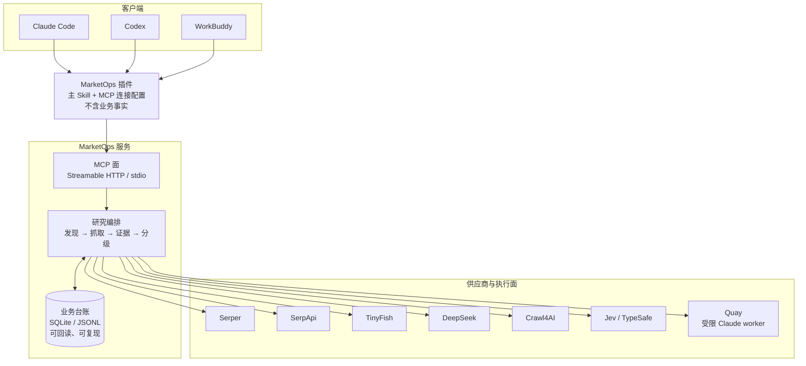
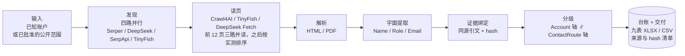

# MarketOps


**把市场研究里那些有固定动作的环节交给机器跑完，只把该由人决定的部分留给人。**

具体做的是：持续维护场地/资产母池，核实责任实体，研究**有证据且有时效性**的联系人和
公开邮箱，并保留可回读的证据。真实外联、回复监控与销售交接在独立授权范围内，当前默认
关闭（`research_only=true`、`send_authorized=false`）。

> **状态**：今天的 MarketOps 能跑完**一轮**完整研究——自己搜、自己读、自己取证、自己分级、
> 自己出交付。还没有做完的是**下一轮由谁发起**。这一半正在建，逐项状态见
> [`docs/AUTOMATION_WORKFLOW.md`](docs/AUTOMATION_WORKFLOW.md)。
> 当前版本是 **0.5.11-rc8**（release candidate），不是正式发行版。


---

## 我们提供什么

| | 今天就能用 | 正在建设 |
|---|---|---|
| **研究** | 一轮完整研究：四路并搜 → 三路并读 → 证据绑定 → 双轴分级 → 九表交付 | — |
| **无人值守** | — | Watch（到期/变化才工作）、Schedule（定时唤醒、幂等）、ActionItem（跟进池）、Notification（一次落账、按订阅投影） |
| **动态研究** | Quay 适配器已就位，需要外部 Quay 部署 | 把「不点开就看不到」的站点交给受限 worker 的完整验收 |
| **外联** | 默认关闭 | 真实外联、回复监控、销售交接（各自独立授权） |

每一项「正在建设」都有一个**可测的关闭条件**，不是一句「做完了」。写法和今天到哪一步，
逐条列在 [`docs/AUTOMATION_WORKFLOW.md`](docs/AUTOMATION_WORKFLOW.md)。

## 一个插件，融合多个项目

宿主只连**一个** MarketOps MCP；供应商之间的差别由插件内部的适配器承担，用户不必分别
安装七家厂商的客户端。


| 项目 | 在这条链里干什么 | 计费口径 |
|---|---|---|
| **Serper** | 搜索、地图 | 按 credit |
| **SerpApi** | 非 Google 引擎（Bing / 百度 / Yandex / Naver / Google Jobs）、地图 | 每月 250 次免费 |
| **TinyFish** | 搜索、页面提取 | 搜索/提取免费；付费 Agent 默认关 |
| **DeepSeek** | 搜索、读页 | $0.75 / 1k 次，失败不计费 |
| **Crawl4AI** | 本地浏览器，保存渲染 HTML | 本地运行，免费 |
| **Jev / TypeSafe** | 对保存的材料做有界语义判断 | 按次 |
| **Quay** | 需要动态判断的研究调度（受限 Claude worker） | 由外部部署决定 |

它们**不是**七个后端：口径、预算、证据只留在 MarketOps 这一层。搜索摘要只用于发现；
抓取成功、文本匹配、模型判断都不自动证明业务事实。

## 三种用法

| 你是 | 用什么 | 入口 |
|---|---|---|
| 业务用户（Claude Code / Codex / WorkBuddy） | **插件**：主 Skill 带研究方法与流程，连一个 MarketOps MCP | `/plugin install marketops-research-assistant --marketplace ProfessorZhi/marketops` |
| 系统集成方 | **MCP 服务**：一个 Streamable HTTP 业务接口 | `python -m marketops.interfaces.mcp` |
| 开发者 | **CLI + Python 包**：`marketops` 是唯一会被装出去的包 | `python -m marketops.interfaces.cli` |

三者是同一套业务代码的三个面，不是三个产品。三端安装的权威步骤见
[`docs/CLIENT_INSTALL.md`](docs/CLIENT_INSTALL.md)（WorkBuddy 那一端仍未验证，文档里如实标着）。

## 架构



分工是固定的：**Skill 给方法，MCP 给事实，供应商只被调用**。客户端不持有业务规则，
供应商适配器不是第二个业务后端。

## 研究流水线



一条**联系路线（ContactRoute）** = 账户 + 人/部门 + 岗位/业务职能 + 字面公开邮箱 + 证据。
没有字面邮箱时，它是 RouteOpportunity 或 ContactSignal——**不能把电话或表单当 D**。

## 分级：两条独立的轴

```text
Account 轴：      discovered / eligible / hold / irrelevant / duplicate …
ContactRoute 轴： A / B / C / D / X
```

两轴不可互换，也不可合并成一个分数。业务规则以 `sources/` 中冻结的 SOP 和
`profiles/` 为准，不以历史试跑中临时使用的标签为准。

## 供应商：谁干什么，按什么顺序

| 任务 | 第 1 | 第 2 | 第 3 |
|---|---|---|---|
| 找目标（网页） | **四路同时** | — | — |
| 找场所（地图） | Serper `maps` | SerpApi `google_maps` | — |
| 读一个页面 / 一个机构的站 | Crawl4AI（本地，免费） | TinyFish fetch | DeepSeek Fetch |
| 判断一批页面（在不在范围内、邮箱归谁） | Jev | 短摘录上由 agent 判断 | — |
| 硬页面（点击展开、分页门户） | TinyFish 付费 Agent | — | 仅当用户在开始时明确同意 |
| 需要动态判断的开放路径 | Quay → 受限 Claude worker | — | — |

### 多路并行 = 各自的失败互不传染

搜索是 **Serper、DeepSeek、SerpApi、TinyFish 同一条 query 一起发**。某一路没额度、
超时或被拒，**只有它自己退出**，其余照常返回，Run 不中断。

读页同理：一次 Run 的**前 12 页由 Crawl4AI、TinyFish、DeepSeek Fetch 三路同时读**，
取信息最全的那份；之后读页顺序按各路**实际交付的效果**排，而不是按某一路的默认优先级。

怎么知道哪一路在起作用：`marketops_search_routes` 给出每路贡献的独立页面数、
A/B 站点数和 `page_readers` 的交付比例。**只有当某一路什么都没加时**才把它从
setup 的 `search_routes` 里去掉——不是因为它慢就去掉。

成本口径（现价，会变，以供应商后台为准）：DeepSeek 搜索/读页 $0.75 / 1k 次，
失败不计费；SerpApi 每月 250 次免费；Crawl4AI 本地免费；Serper `limit` 超过 10
会按第二次 credit 计费。

**Serper 和 SerpApi 各有两个 key 槽位**（`SERPER_API_KEY` / `SERPER_API_KEY_2`，
SerpApi 同理），仅在明确要求时切换，**不自动轮换**。

### 有限降级，不盲目重试

`marketops_research_step` 只在已准入服务之间降级，并记录原因与每次结果。最多三次
尝试；**未知消费、超时、预算耗尽和明确访问限制不触发重试**。语义服务不可用时保留
「待核实」，而不是猜一个等级。

## 什么时候停

跑够就停，跑不够就继续扩——但**只往会产出的方向扩**。

- 目标数量写在 brief 里：`minimum_ab` 是想要的 A+B 人数（默认 50）。
- 只要还有在出 A+B 的来源、而 A+B 又没达标，`marketops_next` 就返回
  `EXPAND_PRODUCTIVE_SOURCE`，让 agent 沿**同一类来源**继续扩（换运动项目、换省份、
  换联合会），而不是换一条没产出的线重来。
- 反过来，某类来源一直被证明是 0，就不该再往里投预算。

这条规则来自一次真实运行：上一次只拿到 12 个 A/B 就收工了，而产出的来源明明还没挖完。

## 安装

Claude Code 一行装：

```bash
/plugin install marketops-research-assistant --marketplace ProfessorZhi/marketops
```

Codex / WorkBuddy / 离线安装包见 [`docs/CLIENT_INSTALL.md`](docs/CLIENT_INSTALL.md)。
仓库里其实有**两个**插件包（一个业务 Skill、一个研究插件），装之前先看
[`plugins/README.md`](plugins/README.md)。

<details>
<summary><b>开发入门</b>（clone、隔离 venv、跑测试、本地启动）</summary>

以下命令在一个全新 clone + 隔离 venv 中实测通过（Linux，Python 3.12）。venv 建在仓库
之外，因为 `tests/test_no_stale_assumptions.py` 会扫描整个仓库树。`MARKETOPS_DATA_ROOT`
必须是仓库之外的显式运行目录。

```bash
git clone https://github.com/ProfessorZhi/marketops.git
cd marketops

python3.12 -m venv ~/.venvs/marketops
. ~/.venvs/marketops/bin/activate
python -m pip install -e ".[dev]" pytest-timeout

CUDA_VISIBLE_DEVICES="" nice -n 10 python -m pytest -q --timeout=300
```

根套件不再排除快照、排序/折叠、slugify 或邮箱归一化测试。公开快照分别校验
脱敏文件的 `public_snapshot_sha256` 与原始历史 pin 的格式，未改写原始 pin。
根套件包含 Linux 专用的 `fcntl` 身份锁模块，全量结果以 GitHub Linux CI 为准。

插件测试单独跑：

```bash
cd plugins/research-tools/marketops-research-assistant
python -m pip install -r requirements-lite.txt
CUDA_VISIBLE_DEVICES="" nice -n 10 python -m unittest discover -s tests -v
```

`requirements-lite.txt` 里没有 pytest，用的是 `unittest discover`，但 `mcp` 与
`typesafe-sdk` 必须装上，否则相关用例走的是「SDK 未安装」的阻断分支。

本地启动：

```bash
export MARKETOPS_DATA_ROOT=/tmp/marketops-dev
mkdir -p "$MARKETOPS_DATA_ROOT"
marketops --help
marketops-controller --help
python -m marketops.interfaces.mcp --check
python -m marketops.interfaces.mcp
```

实测：两个 `--help` 均 rc=0；`--check` 在未配置 `MARKETOPS_MCP_TOKENS` 时
**exit 1 属预期**——服务面能启动，但没有令牌环就「谁都不许」，blocker 会明确写出
缺少哪一项；`python -m marketops.interfaces.mcp` 绑定 `127.0.0.1:8787/mcp`
（Streamable HTTP）。

</details>

<details>
<summary><b>目录</b>（当前实际布局）</summary>

迁移已经走完（`docs/MVP_MIGRATION_PLAN.md` 的 B1–B7 与 Phase C–H 全部落地），
所以这里不再是「一份追赶中的清单」。想知道哪份文档是当前事实、哪份是被冻结的盘点，
读 [`docs/README.md`](docs/README.md)。

```text
marketops/          Python 包 —— 唯一会被装出去的东西（pyproject 的 packages 只有它）
  domain/           纯领域：实体、值对象、规则。不碰网络 / 磁盘 / 厂商
  application/      用例编排：发现、准入定级、预算与上限、派发、证据、运行报告
  ports/            契约：search / acquisition / documents / store / budget / jobs / dispatch / decisions
  adapters/         实现：serper / http / crawl4ai / pypdf / mineru / jev / laya / quay
                     / sqlite / jsonl / feishu / mcp_server（绑 MCP SDK 的那几个模块 ——
                     不是端口，是入口）
  interfaces/       入口与**组合根**：cli.py + composition.py
  security/         权限与合规边界：tokens / catalog / network
  config.py         唯一配置入口
  schema.py         contracts 的导出者
contracts/          由模型导出的 JSON Schema（单向：代码 → 契约，不可手写）
profiles/<scene>/   业务规则：profile / grading / role-matrix
sources/            业务原始材料的逐字节冻结快照（不扫、不改，只追加）
tests/              自动验证
deploy/             部署说明：只有文档，没有部署产物
docs/               架构、契约、SOP、来源与验收 —— 索引在 docs/README.md
```

`services/` 已经不存在。它最后剩下的是 `api/` 与 `feishu_bot/` 两个只有 README
的占位目录，本轮按 `marketops/interfaces/__init__.py` 里写下的处置删掉了 ——
留下的推理搬进了 `docs/NOT_BUILT.md`。

</details>

## 数据、凭据和跨平台

运行数据不进源码仓库。`MARKETOPS_DATA_ROOT` 等逻辑配置决定 state、logs、mirrors、
benchmarks 等位置；凭据使用部署允许的 secret 机制。目标机器实际路径不写死，部署前
读取其最新治理文件。

原始网页/PDF、渲染 DOM、解析文本和派生摘要分别标注来源与变换，不互相冒充。并发写入
走服务端事务/受控入库，JSONL 用于审计和导出，而不是无锁预算状态。

## 文档导航

| 想了解 | 读 |
|---|---|
| 自动化工作流建成什么样、现在到哪一步 | [`docs/AUTOMATION_WORKFLOW.md`](docs/AUTOMATION_WORKFLOW.md) |
| 三端安装（Claude Code / Codex / WorkBuddy） | [`docs/CLIENT_INSTALL.md`](docs/CLIENT_INSTALL.md) |
| 两个插件包分别是什么 | [`plugins/README.md`](plugins/README.md) |
| 整体架构与边界 | [`docs/ARCHITECTURE.md`](docs/ARCHITECTURE.md) |
| MCP 工具目录与行为合同 | [`docs/MCP_SERVICE.md`](docs/MCP_SERVICE.md) |
| 数据契约与 SOP 映射 | [`docs/DATA_MODEL.md`](docs/DATA_MODEL.md)、[`docs/SOP_MAPPING.md`](docs/SOP_MAPPING.md) |
| 部署与供应商拓扑 | [`docs/DEPLOYMENT.md`](docs/DEPLOYMENT.md)、[`docs/DEVELOPMENT_INFRASTRUCTURE.md`](docs/DEVELOPMENT_INFRASTRUCTURE.md) |
| 文档的时效分级与冲突处理 | [`docs/README.md`](docs/README.md) |

**文档分三种，不要混读**：当前事实（根 README、`ARCHITECTURE.md`、`AUTOMATION_WORKFLOW.md`）、
冻结的历史盘点（`docs/CURRENT_STATE.md`，只在原 revision 上成立）、某次构建的运行回执
（`MVP_ACCEPTANCE_REPORT*.md`、`B17_*_RUN_*.md`）。历史盘点不改写，新事实另行追加。
