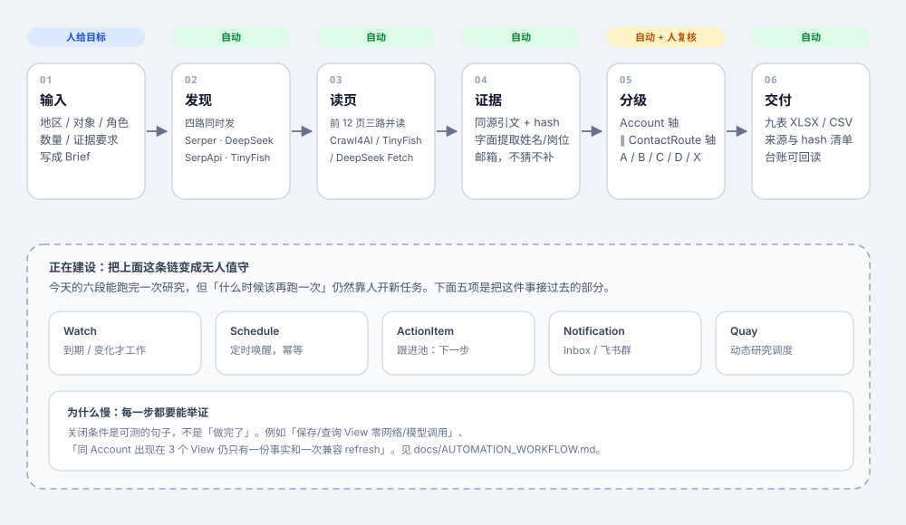
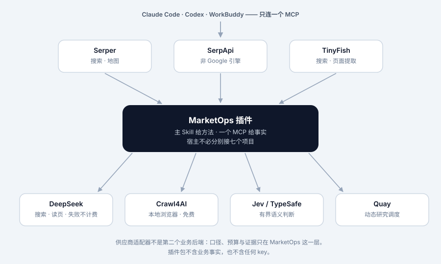
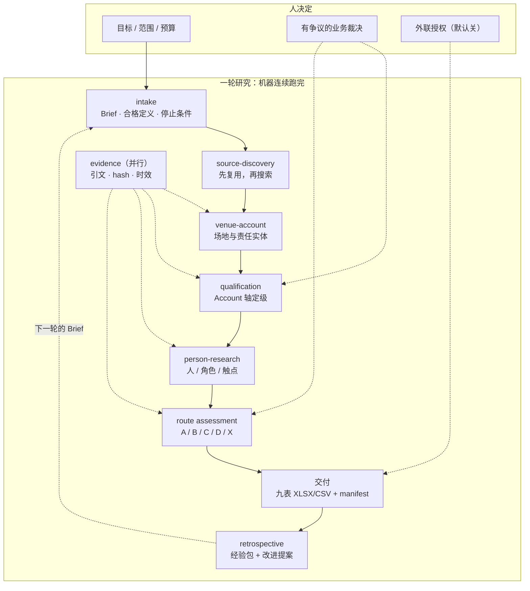
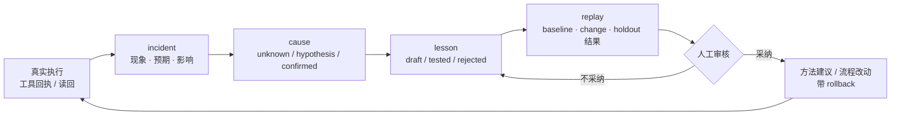
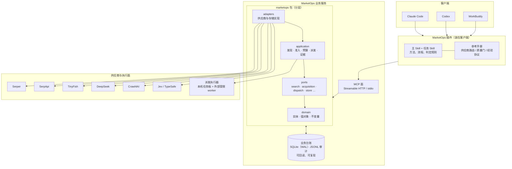
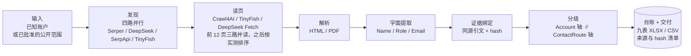

# MarketOps


**把市场研究里那些有固定动作的环节交给机器跑完，只把该由人决定的部分留给人。**

具体做的是：持续维护场地/资产母池，核实责任实体，研究**有证据且有时效性**的联系人和
公开邮箱，把结果落成可回读的台账与表格。真实外联、回复监控与销售交接在独立授权范围内，
当前默认关闭（`research_only=true`、`send_authorized=false`）。

> **版本**：0.5.11-rc9，release candidate。它已覆盖一轮完整研究的全部阶段；无人值守
> 的下一轮触发（Watch / Schedule / ActionItem / Notification）尚未交付，关闭条件见
> [`docs/AUTOMATION_WORKFLOW.md`](docs/AUTOMATION_WORKFLOW.md)。在该部分交付之前，
> 每一轮研究仍由人或外部调度器发起。



---

## 目录

- [能力范围](#能力范围)
- [一个插件，融合多个项目](#一个插件融合多个项目)
- [业务知识：这一行真正难的地方](#业务知识这一行真正难的地方)
- [科学设计的工作流](#科学设计的工作流)
- [经验如何沉淀下来](#经验如何沉淀下来)
- [架构](#架构)
- [安装与更新](#安装与更新)
- [三种用法](#三种用法)
- [供应商：谁干什么，按什么顺序](#供应商谁干什么按什么顺序)
- [什么时候停](#什么时候停)
- [数据、凭据和跨平台](#数据凭据和跨平台)
- [开发入门](#开发入门)
- [文档导航](#文档导航)

## 能力范围

MarketOps 覆盖一次市场研究的完整生命周期，并把每个阶段的产物写进同一份可回读的台账。

- **研究执行。** 给定已批准的范围与目标数量，系统完成来源发现、页面读取、字面信息提取、
  证据绑定、双轴分级与交付生成。搜索与读页均为多路并行，单路失败不影响整轮。
- **责任实体验证。** 场地与组织分开记录；一个场地可以有多个运营方，一个组织可以运营多个
  场地，关联带有责任类型。资格判断只在已批准的 Scene 规则下进行。
- **联系路线评估。** 输出的是可审查的路线（账户 + 人/部门 + 职能 + 字面公开邮箱 + 证据），
  而不是一份邮箱列表。没有字面邮箱时，结果停在 Opportunity 或 Signal，不降级成等级。
- **持续维护。** 母池、台账、来源与历史判断都保留在服务端；读取接口支持按工作流、视图与
  时间回看。
- **交付。** 每轮产出九表 XLSX / CSV、来源与哈希清单，以及一份复盘经验包。
- **动态研究。** 对需要点击、翻页或视觉判断的站点，由部署方提供的受限 worker 执行；服务端
  负责任务板、身份、构建一致性与结果回传。
- **外联。** 不作为默认能力。真实发信、回复监控与销售交接需要独立的连接器与授权，当前
  状态下服务端以 `research_only=true`、`send_authorized=false` 运行。

尚未交付的部分是**无人值守的下一轮**：Watch、Schedule、ActionItem 与 Notification。
这四项各自有可测的关闭条件，写在
[`docs/AUTOMATION_WORKFLOW.md`](docs/AUTOMATION_WORKFLOW.md)，不以完成百分比描述。

## 一个插件，融合多个项目

宿主只连**一个** MarketOps MCP；供应商之间的差别由插件内部的适配器承担，用户不必分别
安装各家厂商的客户端，也不必在对话里决定该用哪一家。



| 项目 | 在这条链里干什么 | 计费口径 |
|---|---|---|
| **Serper** | 搜索、地图 | 按 credit |
| **SerpApi** | 非 Google 引擎（Bing / 百度 / Yandex / Naver / Google Jobs）、地图 | 每月 250 次免费 |
| **TinyFish** | 搜索、页面提取 | 搜索/提取免费；付费 Agent 默认关 |
| **DeepSeek** | 搜索、读页 | $0.75 / 1k 次，失败不计费 |
| **Crawl4AI** | 本地浏览器，保存渲染 HTML | 本地运行，免费 |
| **Jev / TypeSafe** | 对保存的材料做有界语义判断 | 按次 |

它们**不是**六个后端：口径、预算、证据只留在 MarketOps 这一层。搜索摘要只用于发现；
抓取成功、文本匹配、模型判断都不自动证明业务事实。

同一份「融合」也发生在 Skill 上：插件里住的不是一份大提示词，而是一组按任务拆开的
Skill、两个子代理和一套参考手册——见 [科学设计的工作流](#科学设计的工作流)。

## 业务知识：这一行真正难的地方

业务口径来自 `sources/` 中逐字节冻结的 SOP 与 `profiles/<scene>/`，不以历史试跑里
临时用过的标签为准。下面几条是代码、测试和验收都围绕它们建的**业务不变量**：

- **能抓到 ≠ 事实可信。** 搜索摘要只是 `discovered`；网页返回 200 但如果正文是
  WAF / 验证码，仍算 `blocked`。
- **候选 ≠ 联系人。** 一个人名、一个同域邮箱不能跨组织自动合并。岗位、采购权、
  邮箱可投递性是三件不同的事，各有各的证据。
- **两条轴，不可互换。** `Account` 轴回答「这家机构在这个 Scene 里是否合格」，
  `ContactRoute` 轴回答「这条路线的可联系等级是 A/B/C/D 还是 X」。一个不能推出另一个，
  更不能合成一个分数。
- **邮箱必须是字面出现过的。** 从抓到的页面文本里实际出现的地址才算；搜索 snippet
  不能当邮箱证据；电话和网页表单是 Signal，不是 D。
- **未知 ≠ 零。** `unknown`、`hold`、`blocked`、空输入、没有检查，在报告和表格里是
  五个不同的东西。
- **一站可以有多块场地。** 不能按域名去重抹掉实体；一个组织可以运营多个场地，关联
  必须带责任类型（owner / operator / maintainer / procurement）。
- **审查者不能凭状态自证成功。** 一个 `ready` 必须能回读到来源内容、邮箱字面证据和
  已记录的人工审查，不能只检查一格布尔值。

完整的判定表见插件里的
[`QUALITY_GATES.md`](plugins/research-tools/marketops-research-assistant/references/QUALITY_GATES.md)
与仓库里的 [`docs/SOP_MAPPING.md`](docs/SOP_MAPPING.md)。

## 科学设计的工作流

流程不是「让 agent 自由发挥」，而是把研究拆成**有输入、有产物、有交接校验**的阶段。
每个阶段都能单独重跑，上一阶段的产物是下一阶段的输入，任何一步缺证据都会停在原地
而不是猜一个结论。



设计上的几个取舍，都是被真实运行逼出来的：

- **先查存量，再决定花不花钱。** 优先补「合格组织缺负责人」「已有人但缺现职证据」
  「已提取未保存」这类缺口，而不是每轮从零搜。
- **多路并行 = 失败互不传染。** 搜索是四路同一条 query 一起发；某一路没额度、超时或
  被拒，只有它自己退出。前 12 页由三路同时读，取信息最全的那份；之后读页顺序按各路
  **实际交付的效果**排。
- **有限降级，不盲目重试。** 最多三次尝试；未知消费、超时、预算耗尽和明确访问限制
  不触发重试。语义服务不可用时保留「待核实」，而不是猜一个等级。
- **对账按同一单位、同一输入唯一键。** 有未解释对象就记 `UNACCOUNTED_OUTPUT`，
  不能用减法反推「丢失条数」。
- **变更要带版本。** Brief、SOP、审核标准与成本限额的变化可追溯；旧交付出修正版，
  不删除旧测量。

## 经验如何沉淀下来

每一轮结束交付**两个包**：业务结果包（给客户）和经验包（给下一次）。经验包不是第二份
客户数据库，也不自动改规则——它是「候选经验 + 证据 + 复验路径」。



固定下来的纪律：

- **先记现象，再写根因。** `cause.root_cause_status` 只有 `confirmed` 才配得上「已证实」，
  而且必须有复验定位；脚本不替人证明因果。
- **反例比结论重要。** lesson 可以带 `counterexample_refs`；没有反例不等于不存在反例。
- **训练集与留出集不重叠。** replay 的 `training_cases` / `holdout_cases` 分开记，
  完成必须两者都有结果引用。
- **未测量的数值就是 `null`。** 时间、成本、命中率的收益没有测量就写
  `UNKNOWN`，不写一个看起来合理的百分比。
- **经验可以被召回，也可以被反驳。** MCP 提供 `marketops_experience_recall` 与
  `marketops_experience_feedback`，反馈绑定到 `artifact:<id>` 或 `event:<sequence>`，
  保留反例并影响后续方法建议。

合同细节见
[`EXPERIENCE_PROTOCOL.md`](plugins/research-tools/marketops-research-assistant/references/EXPERIENCE_PROTOCOL.md)。

## 架构



分工是固定的：**Skill 给方法，MCP 给事实，供应商只被调用**。客户端不持有业务规则，
供应商适配器不是第二个业务后端。

### 研究流水线



一条**联系路线（ContactRoute）** = 账户 + 人/部门 + 岗位/业务职能 + 字面公开邮箱 + 证据。
没有字面邮箱时，它是 RouteOpportunity 或 ContactSignal——**不能把电话或表单当 D**。

### 分级：两条独立的轴

```text
Account 轴：      discovered / eligible / hold / irrelevant / duplicate …
ContactRoute 轴： A / B / C / D / X
```

两轴不可互换，也不可合并成一个分数。业务规则以 `sources/` 中冻结的 SOP 和
`profiles/` 为准，不以历史试跑中临时使用的标签为准。

### 可替换的执行面

开放式页面（要点开、要翻页、要看图）不是确定性代码能做完的。这类工作由一个**受限
worker** 接手，而 MarketOps 只定义接口，不捆绑具体实现：

- 服务侧把 work item 放进**本机任务板**（SQLite，WAL，`claim_next()` 原子领取）；
- worker 由部署方通过环境变量接入（`MARKETOPS_RESEARCH_DELEGATE`），只看到自己那一件
  任务的提示词与工具面，拿不到整份业务状态；
- 身份、构建一致性、运行目录隔离与退出码都是硬约束；没配执行器的部署会**如实报告**
  「这批工作没有交出去」，而不是假装成功。

也就是说：换一个 worker 运行时不需要改业务代码，也不需要插件知道它是谁。

## 安装与更新

**发布与更新都走 GitHub。** 仓库既是源码，也是插件 marketplace；第一次安装和之后的
升级都从同一个地方取。

### 第一次安装（Claude Code）

```bash
/plugin marketplace add ProfessorZhi/marketops
/plugin install marketops-research-assistant@marketops
```

第一次安装后跑一次 `python scripts/preflight.py`，确认依赖与凭据齐；再跑
`python scripts/client_install_probe.py`，确认客户端配置落到了它真正会读的位置。

### 更新

```bash
/plugin marketplace update marketops
/plugin update marketops-research-assistant@marketops
```

版本号以 `plugin.json` 的 `version` 为权威。它没递增时，`claude plugin update` 会判定
「已是最新」并静默什么都不做——所以发版必须先改这一处。

### 让 agent 自己装

仓库里带了一份**给 agent 读的安装说明**
（[`AGENT_INSTALL.md`](plugins/research-tools/marketops-research-assistant/AGENT_INSTALL.md)）：
用户把 ZIP 路径和自己的 key 发给 agent，agent 按顺序解包、装运行时、把 key 写进系统
凭据库、再启动首次配置窗口。每一步都写明了失败时怎么重跑、以及**什么不许做**（不改包内
文件、不把 key 写进文件或命令行、不替用户注册或付费）。

### 其它客户端

| 客户端 | 安装方式 | 验证状态 |
|---|---|---|
| **Claude Code** | 上面的两条命令；或 `setup_clients.py --client claude --apply --bootstrap-runtime` | 有安装回执 |
| **Codex** | `setup_clients.py --client codex --register-codex` | 有安装回执 |
| **WorkBuddy** | `setup_clients.py --client workbuddy`，导入在客户端内完成 | **未验证**（文档里如实标着） |

三端的权威步骤见 [`docs/CLIENT_INSTALL.md`](docs/CLIENT_INSTALL.md)。仓库里其实有
**两个**插件包（一个业务 Skill、一个研究插件），装之前先看
[`plugins/README.md`](plugins/README.md)。

## 三种用法

| 你是 | 用什么 | 入口 |
|---|---|---|
| 业务用户（Claude Code / Codex / WorkBuddy） | **插件**：主 Skill 带研究方法与流程，连一个 MarketOps MCP | `/plugin install marketops-research-assistant --marketplace ProfessorZhi/marketops` |
| 系统集成方 | **MCP 服务**：一个 Streamable HTTP 业务接口 | `python -m marketops.interfaces.mcp` |
| 开发者 | **CLI + Python 包**：`marketops` 是唯一会被装出去的包 | `python -m marketops.interfaces.cli` |

三者是同一套业务代码的三个面，不是三个产品。

## 供应商：谁干什么，按什么顺序

| 任务 | 第 1 | 第 2 | 第 3 |
|---|---|---|---|
| 找目标（网页） | **四路同时** | — | — |
| 找场所（地图） | Serper `maps` | SerpApi `google_maps` | — |
| 读一个页面 / 一个机构的站 | Crawl4AI（本地，免费） | TinyFish fetch | DeepSeek Fetch |
| 判断一批页面（在不在范围内、邮箱归谁） | Jev | 短摘录上由 agent 判断 | — |
| 硬页面（点击展开、分页门户） | TinyFish 付费 Agent | — | 仅当用户明确同意 |
| 需要动态判断的开放路径 | 派发执行器 → 受限 worker | — | — |

### 多路并行 = 各自的失败互不传染

搜索是 **Serper、DeepSeek、SerpApi、TinyFish 同一条 query 一起发**。某一路没额度、
超时或被拒，**只有它自己退出**，其余照常返回，Run 不中断。

怎么知道哪一路在起作用：`marketops_search_routes` 给出每路贡献的独立页面数、
A/B 站点数和 `page_readers` 的交付比例。**只有当某一路什么都没加时**才把它从
setup 的 `search_routes` 里去掉——不是因为它慢就去掉。

成本口径（现价，会变，以供应商后台为准）：DeepSeek 搜索/读页 $0.75 / 1k 次，
失败不计费；SerpApi 每月 250 次免费；Crawl4AI 本地免费；Serper `limit` 超过 10
会按第二次 credit 计费。

**Serper 和 SerpApi 各有两个 key 槽位**（`SERPER_API_KEY` / `SERPER_API_KEY_2`，
SerpApi 同理），仅在明确要求时切换，**不自动轮换**。

## 什么时候停

跑够就停，跑不够就继续扩——但**只往会产出的方向扩**。

- 目标数量写在 brief 里：`minimum_ab` 是想要的 A+B 人数（默认 50）。
- 只要还有在出 A+B 的来源、而 A+B 又没达标，`marketops_next` 就返回
  `EXPAND_PRODUCTIVE_SOURCE`，让 agent 沿**同一类来源**继续扩（换运动项目、换省份、
  换联合会），而不是换一条没产出的线重来。
- 反过来，某类来源一直被证明是 0，就不该再往里投预算。

这条规则来自一次真实运行：上一次只拿到 12 个 A/B 就收工了，而产出的来源明明还没挖完。

## 数据、凭据和跨平台

运行数据不进源码仓库。`MARKETOPS_DATA_ROOT` 等逻辑配置决定 state、logs、mirrors、
benchmarks 等位置；凭据使用部署允许的 secret 机制（Windows 上是凭据管理器）。目标机器
实际路径不写死，部署前读取其最新治理文件。

原始网页/PDF、渲染 DOM、解析文本和派生摘要分别标注来源与变换，不互相冒充。并发写入
走服务端事务/受控入库，JSONL 用于审计和导出，而不是无锁预算状态。

**Key 只进本机凭据库或环境变量，不进包、不进仓库、不进日志。** 写入入口是
`research_credentials.py configure --stdin`，不要用命令行参数传值。

## 开发入门

以下命令在一个全新 clone + 隔离 venv 中实测通过（Linux，Python 3.12）。venv 建在仓库
之外，因为 `tests/test_no_stale_assumptions.py` 会扫描整个仓库树。`MARKETOPS_DATA_ROOT`
必须是仓库之外的显式运行目录。

```bash
git clone https://github.com/ProfessorZhi/marketops.git
cd marketops

python3.12 -m venv ~/.venvs/marketops
. ~/.venvs/marketops/bin/activate
python -m pip install -e ".[dev]" pytest-timeout

CUDA_VISIBLE_DEVICES="" nice -n 10 python -m pytest -q --timeout=300
```

插件测试单独跑：

```bash
cd plugins/research-tools/marketops-research-assistant
python -m pip install -r requirements-lite.txt
CUDA_VISIBLE_DEVICES="" nice -n 10 python -m unittest discover -s tests -v
```

`requirements-lite.txt` 里没有 pytest，用的是 `unittest discover`，但 `mcp` 与
`typesafe-sdk` 必须装上，否则相关用例走的是「SDK 未安装」的阻断分支。

本地启动：

```bash
export MARKETOPS_DATA_ROOT=/tmp/marketops-dev
mkdir -p "$MARKETOPS_DATA_ROOT"
marketops --help
marketops-controller --help
python -m marketops.interfaces.mcp --check
python -m marketops.interfaces.mcp
```

实测：两个 `--help` 均 rc=0；`--check` 在未配置 `MARKETOPS_MCP_TOKENS` 时
**exit 1 属预期**——服务面能启动，但没有令牌环就「谁都不许」，blocker 会明确写出
缺少哪一项；`python -m marketops.interfaces.mcp` 绑定 `127.0.0.1:8787/mcp`
（Streamable HTTP）。

### 目录

```text
marketops/          Python 包 —— 唯一会被装出去的东西（pyproject 的 packages 只有它）
  domain/           纯领域：实体、值对象、规则。不碰网络 / 磁盘 / 厂商
  application/      用例编排：发现、准入定级、预算与上限、派发、证据、运行报告
  ports/            契约：search / acquisition / documents / store / budget / jobs / dispatch / decisions
  adapters/         实现：serper / http / crawl4ai / pypdf / mineru / jev / laya
                     / local_board（派发执行器）/ sqlite / jsonl / feishu / mcp_server
  interfaces/       入口与**组合根**：cli.py + composition.py + research_worker.py
  security/         权限与合规边界：tokens / catalog / network
  config.py         唯一配置入口
  schema.py         contracts 的导出者
contracts/          由模型导出的 JSON Schema（单向：代码 → 契约，不可手写）
profiles/<scene>/   业务规则：profile / grading / role-matrix
sources/            业务原始材料的逐字节冻结快照（不扫、不改，只追加）
tests/              自动验证
deploy/             部署说明：只有文档，没有部署产物
docs/               架构、契约、SOP、来源与验收 —— 索引在 docs/README.md
```

## 文档导航

| 想了解 | 读 |
|---|---|
| 自动化工作流建成什么样、现在到哪一步 | [`docs/AUTOMATION_WORKFLOW.md`](docs/AUTOMATION_WORKFLOW.md) |
| 三端安装（Claude Code / Codex / WorkBuddy） | [`docs/CLIENT_INSTALL.md`](docs/CLIENT_INSTALL.md) |
| 两个插件包分别是什么 | [`plugins/README.md`](plugins/README.md) |
| 整体架构与边界 | [`docs/ARCHITECTURE.md`](docs/ARCHITECTURE.md) |
| MCP 工具目录与行为合同 | [`docs/MCP_SERVICE.md`](docs/MCP_SERVICE.md) |
| 数据契约与 SOP 映射 | [`docs/DATA_MODEL.md`](docs/DATA_MODEL.md)、[`docs/SOP_MAPPING.md`](docs/SOP_MAPPING.md) |
| 业务执行手册（一项研究从需求到交付） | [`BUSINESS_PLAYBOOK.md`](plugins/research-tools/marketops-research-assistant/references/BUSINESS_PLAYBOOK.md) |
| 质量门与人工复核停止条件 | [`QUALITY_GATES.md`](plugins/research-tools/marketops-research-assistant/references/QUALITY_GATES.md) |
| 经验如何记录与复验 | [`EXPERIENCE_PROTOCOL.md`](plugins/research-tools/marketops-research-assistant/references/EXPERIENCE_PROTOCOL.md) |
| 部署与供应商拓扑 | [`docs/DEPLOYMENT.md`](docs/DEPLOYMENT.md)、[`docs/DEVELOPMENT_INFRASTRUCTURE.md`](docs/DEVELOPMENT_INFRASTRUCTURE.md) |
| 文档的时效分级与冲突处理 | [`docs/README.md`](docs/README.md) |

**文档分三种，不要混读**：当前事实（根 README、`ARCHITECTURE.md`、`AUTOMATION_WORKFLOW.md`）、
冻结的历史盘点（`docs/CURRENT_STATE.md`，只在原 revision 上成立）、某次构建的运行回执
（`MVP_ACCEPTANCE_REPORT*.md`、`B17_*_RUN_*.md`）。历史盘点不改写，新事实另行追加。
