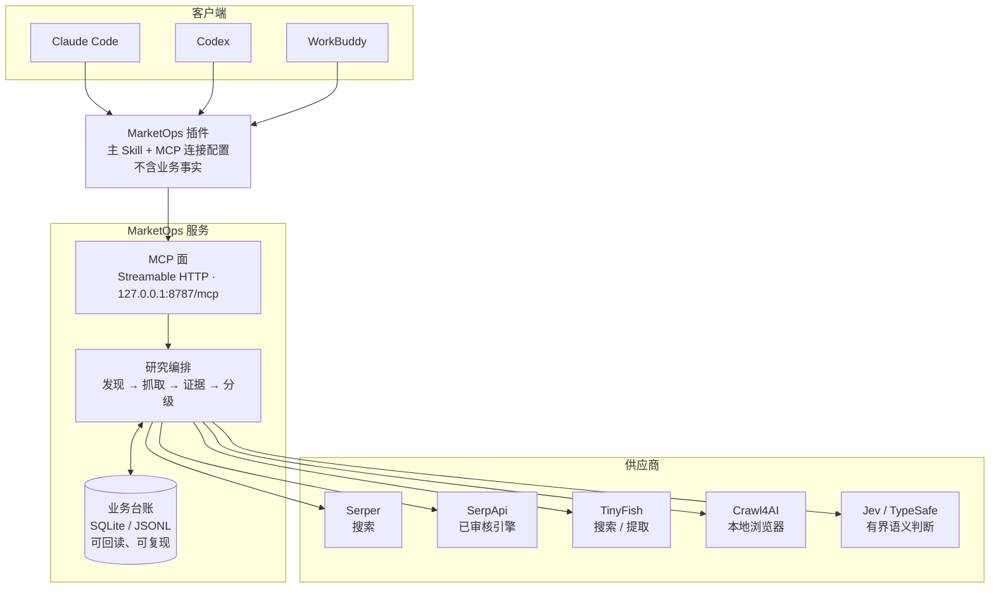
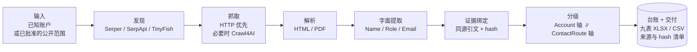

# MarketOps


持续维护场地/资产母池，核实责任实体，研究**有证据且有时效性**的联系人和公开邮箱，
并保留可回读的证据。真实外联、回复监控与销售交接在独立授权范围内，当前默认关闭
（`research_only=true`、`send_authorized=false`）。

> 本仓库现在是 **release candidate 0.5.11-rc6**。对外交付形态 = 一个可安装的
> MarketOps 插件（主 Skill + MCP 连接配置）+ 一个持久化业务 MCP 服务。
> 插件包的安装与验收见 [`plugins/research-tools/marketops-research-assistant`](plugins/research-tools/marketops-research-assistant/)。

---

## 三种用法

| 你是 | 用什么 | 入口 |
|---|---|---|
| 业务用户（Claude Code / Codex / WorkBuddy） | **插件**：主 Skill 带研究方法与流程，连一个 MarketOps MCP | 本仓库 [Release](https://github.com/ProfessorZhi/marketops/releases) 的安装包 |
| 系统集成方 | **MCP 服务**：一个 Streamable HTTP 业务接口，不要求用户分别接各家供应商 | `python -m marketops.interfaces.mcp` |
| 开发者 | **CLI + Python 包**：`marketops` 是唯一会被装出去的包 | `python -m marketops.interfaces.cli` |

三者是同一套业务代码的三个面，不是三个产品。

## 架构



分工是固定的：**Skill 给方法，MCP 给事实，供应商只被调用**。客户端不持有业务规则，
供应商适配器不是第二个业务后端。

## 研究流水线



一条**联系路线（ContactRoute）** = 账户 + 人/部门 + 岗位/业务职能 + 字面公开邮箱 + 证据。
没有字面邮箱时，它是 RouteOpportunity 或 ContactSignal——**不能把电话或表单当 D**。

搜索摘要只用于发现；抓取成功、文本匹配、模型判断都不自动证明业务事实。

## 分级：两条独立的轴

```text
Account 轴：      discovered / eligible / hold / irrelevant / duplicate …
ContactRoute 轴： A / B / C / D / X
```

两轴不可互换，也不可合并成一个分数。业务规则以 `sources/` 中冻结的 SOP 和
`profiles/` 为准，不以历史试跑中临时使用的标签为准。

## 供应商与降级

| 项目 | 用途 | 连接 |
|---|---|---|
| Serper | 来源搜索 | 受管 REST |
| SerpApi | 已审核搜索引擎 | 内嵌官方 MCP |
| TinyFish | 搜索、网页提取 | 内嵌官方 MCP |
| Crawl4AI | 本地浏览器抓取，保存渲染 HTML | SDK + Chromium + 受限出口 |
| Jev / TypeSafe | 对已保存材料做有界语义判断 | SDK |

`marketops_research_step` 只在已准入服务之间做**有限降级**，并记录原因与每次结果。
最多三次尝试；未知消费、超时、预算耗尽和明确访问限制**不触发盲目重试**。
语义服务不可用时保留待核实状态，而不是猜一个等级。

## 开发入门

以下命令在一个全新 clone + 隔离 venv 中实测通过（Linux，Python 3.12）。venv 建在仓库
之外，因为 `tests/test_no_stale_assumptions.py` 会扫描整个仓库树。`MARKETOPS_DATA_ROOT`
必须是仓库之外的显式运行目录。

### Clone

```bash
git clone https://github.com/ProfessorZhi/marketops.git
cd marketops
```

### 装依赖

```bash
python3.12 -m venv ~/.venvs/marketops
. ~/.venvs/marketops/bin/activate
python -m pip install -e ".[dev]" pytest-timeout
```

### 跑测试

```bash
CUDA_VISIBLE_DEVICES="" nice -n 10 python -m pytest -q --timeout=300
```

根套件不再排除快照、排序/折叠、slugify 或邮箱归一化测试。公开快照分别校验
脱敏文件的 `public_snapshot_sha256` 与原始历史 pin 的格式，未改写原始 pin。
排序与折叠断言遵循存储接口的既定契约。

根套件包含 Linux 专用的 `fcntl` 身份锁模块，全量结果以 GitHub Linux CI 为准。
Windows 安装流程由 `research-plugin-e2e` 的 Windows job 验证；Windows 上直接跑完整
离线测试还会遇到既有夹具对 HOME、文件权限、短路径别名和 SQLite 句柄清理的假设。

插件测试单独跑：

```bash
cd plugins/research-tools/marketops-research-assistant
python -m pip install -r requirements-lite.txt
CUDA_VISIBLE_DEVICES="" nice -n 10 python -m unittest discover -s tests -v
```

完整插件套件的当前数量与结果见 `research-plugin-e2e` 的 `offline-3.12` 日志。
`requirements-lite.txt` 里没有 pytest，用的是 `unittest discover`，但 `mcp` 与
`typesafe-sdk` 必须装上，否则相关用例走的是「SDK 未安装」的阻断分支。

### 本地启动

```bash
export MARKETOPS_DATA_ROOT=/tmp/marketops-dev
mkdir -p "$MARKETOPS_DATA_ROOT"
marketops --help
marketops-controller --help
python -m marketops.interfaces.mcp --check
python -m marketops.interfaces.mcp
```

实测：两个 `--help` 均 rc=0；`--check` 在未配置 `MARKETOPS_MCP_TOKENS` 时
**exit 1 属预期**——服务面能启动，但没有令牌环就「谁都不许」，blocker 会明确写出
缺少哪一项；`python -m marketops.interfaces.mcp` 绑定 `127.0.0.1:8787/mcp`
（Streamable HTTP）。

## 目录

**这一节描述的是当前实际的布局。** 迁移已经走完（`docs/MVP_MIGRATION_PLAN.md`
的 B1–B7 与 Phase C–H 全部落地），所以这里不再是「一份追赶中的清单」。
`docs/MVP_MIGRATION_PLAN.md` §1 也画了一棵树，但那是 **Phase A 定的目标树** ——
拿它对照「还差什么」，不要拿它查文件在哪。想知道哪份文档是当前事实、哪份是被冻结的
盘点，读 `docs/README.md`。

```text
marketops/          Python 包 —— 唯一会被装出去的东西（pyproject 的 packages 只有它）
  domain/           纯领域：实体、值对象、规则。不碰网络 / 磁盘 / 厂商
  application/      用例编排：发现、准入定级、预算与上限、派发、证据、运行报告
  ports/            契约：search / acquisition / documents / store / budget / jobs / dispatch / decisions
  adapters/         实现：serper / http / crawl4ai / pypdf / mineru / jev / laya
                     / sqlite / jsonl / feishu / mcp_server（绑 MCP SDK 的那几个模块 ——
                     不是端口，是入口）
  interfaces/       入口与**组合根**：cli.py + composition.py
                     （唯一允许点名具体厂商 adapter 的两个落点）
  security/         权限与合规边界：tokens（主体从哪来）/ catalog（判什么）
                     / network（允许去哪、允许绑哪）
  config.py         唯一配置入口 —— 模块不是包，理由写在它的 docstring 里
  schema.py         contracts 的导出者 —— 留在顶层，理由同上
contracts/          由模型导出的 JSON Schema（**单向：代码 → 契约**，不可手写）
profiles/<scene>/   业务规则：profile / grading / role-matrix
sources/            业务原始材料的**逐字节冻结快照**（不扫、不改，只追加）
tests/              自动验证（unit / contract / integration 的拆分见
                     docs/MVP_MIGRATION_PLAN.md，尚未执行）
deploy/             部署说明：只有文档，没有部署产物
docs/               架构、契约、SOP、来源与验收 —— 索引在 docs/README.md
```

`services/` 已经不存在。它最后剩下的是 `api/` 与 `feishu_bot/` 两个**只有 README
的占位目录**，本轮按 `marketops/interfaces/__init__.py` 里写下的处置删掉了 ——
留下的推理搬进了 `docs/NOT_BUILT.md`（为什么现在不建，以及真要建时哪些约束已经被固定）。

## 数据、凭据和跨平台

运行数据不进源码仓库。`MARKETOPS_DATA_ROOT` 等逻辑配置决定 state、logs、mirrors、
benchmarks 等位置；凭据使用部署允许的 secret 机制。目标机器实际路径不写死，部署前
读取其最新治理文件。

原始网页/PDF、渲染 DOM、解析文本和派生摘要分别标注来源与变换，不互相冒充。并发写入
走服务端事务/受控入库，JSONL 用于审计和导出，而不是无锁预算状态。

路径遵循既有 `pathlib` 和显式配置方式；第三方包/模型/浏览器版本固定并记录；不要为了
演示复制源码、凭据或大模型缓存到不合规目录。

## 实现状态

当前 `main` 的研究引擎、开发机上的实验 worktree 与目标 MCP MVP 不应混称同一个完成
状态。上一轮只读核查中报告了未实现的 API、旧 canonical remote、试跑预算计数竞争、
研究 gate 与 SOP 口径差异。它们是当时的事实，不是本 README 对生产的实时检查。

本轮实现前核实活跃分支与当前代码，保留旧证据，另做版本化纠正。MVP 不应要求用户凭空
编造 Account 清单；支持已存在来源 receipt、已知账户或批准的公开发现范围。

Crawl4AI、Jev、Laya 已升级为本轮必需集成，而不是后续选做；MinerU 等重型解析器、生产
飞书/Hosting 接线和真实外联仍在各自独立范围。完整验收以 `docs/MCP_SERVICE.md` 的逐项
真实凭证为准。

## 文档导航

| 想了解 | 读 |
|---|---|
| 整体架构与边界 | [`docs/ARCHITECTURE.md`](docs/ARCHITECTURE.md) |
| MCP 工具目录与行为合同 | [`docs/MCP_SERVICE.md`](docs/MCP_SERVICE.md) |
| 数据契约与 SOP 映射 | [`docs/DATA_MODEL.md`](docs/DATA_MODEL.md)、[`docs/SOP_MAPPING.md`](docs/SOP_MAPPING.md) |
| 部署与供应商拓扑 | [`docs/DEPLOYMENT.md`](docs/DEPLOYMENT.md)、[`docs/DEVELOPMENT_INFRASTRUCTURE.md`](docs/DEVELOPMENT_INFRASTRUCTURE.md) |
| 文档的时效分级与冲突处理 | [`docs/README.md`](docs/README.md) |

**文档分三种，不要混读**：当前事实（`ARCHITECTURE.md`、根 README）、冻结的历史盘点
（`docs/CURRENT_STATE.md`，只在原 revision 上成立）、某次构建的运行回执
（`MVP_ACCEPTANCE_REPORT*.md`）。历史盘点不改写，新事实另行追加。
