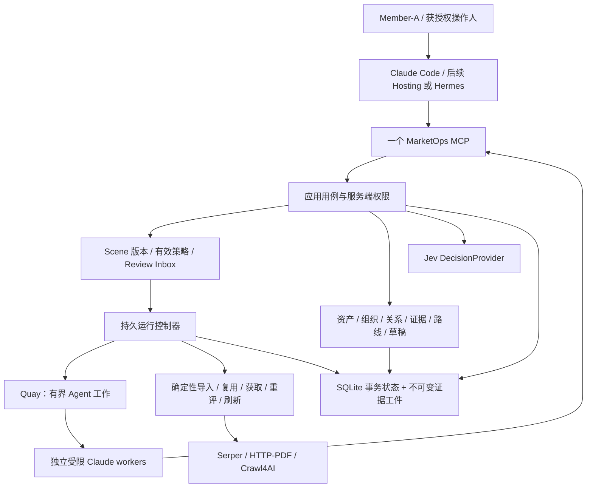

# Member-A 驱动的 MarketOps 自动化架构

更新：2026-09-27（初版2026-09-26）。状态：**待实现的增量设计，不是验收报告或生产启用授权**。

产品基线 `df689f52e0e07dc35b88af7a3a5dd48808008a75`（PR #6）；行为分析基线 `example-session-repo@06cdae471f794e37877637d69ea93d1c020272a2`（PR #1）。本次只读核对与文档修改，没有运行新的业务研究。来源、限制与代码证据见 [证据说明](research/MEMBER_A_AUTOMATION_EVIDENCE_2026-09-26.md)。实施顺序和关闭条件唯一维护在 [执行计划](MEMBER_A_AUTOMATION_EXECUTION_PLAN.md)。

本文在本轮增量议题上优先于 2026-09-23 设计中的旧实现盘点和“六项集成全部必需”门槛；业务授权仍服从冻结 SOP 及明确获批准的变更。未讨论的既有网络、权限、证据、预算与幂等约束继续有效。

新增专门规格：[产品线与Scene模型](PRODUCT_LINE_AND_SCENE_MODEL.md)、[采集与供应商接入](ACQUISITION_AND_PROVIDER_DESIGN.md)，以及 [2026-09-27核对](research/MARKET_MODEL_ACCESS_REVIEW_2026-09-27.md)。本轮细化产品/Offer/地区/场景/任职/反馈的组合与访问诊断，执行项并入原计划。若旧聊天建议“产品不同一律拆Scene”“母池只能是场地”“Ray ID说明IP封禁”，以新规格的条件化模型与证据边界为准。

## 1. 产品目标：少让 Member-A 操作，不替 Member-A 擅自授权

目标体验是：Member-A 给出地区、应用场景、产品、目标与预算，批准运行范围后，系统自己补池、研究、续跑、重查、整理结果和草稿；Member-A 不再抄名单、搬文件、反复说“继续”、追查哪个数字是真的。

保留给人的工作是新的业务取舍、范围/预算扩张、未解决的规则冲突和外部动作授权。已批准规则下的重复执行不应每次重问。人工业务决策、数据纠错、模型建议与系统权限是四种不同记录。

**不以工具数、测试数、邮箱事件数或一份完成报告作为自动化程度。** 衡量的是：在质量、安全和范围不降低的情况下，每批可用结果需要多少次人工搬运、纠错、催续跑，以及多少人实际花费的操作时间。分析图谱的 78 行是登记样本，不是 78 个独立功能或 Member-A 的时间分布。

## 2. 产品分三道交付门，不再一个模糊的 READY

| 门 | 用户得到什么 | 必须证明什么 |
|---|---|---|
| R1：可用研究链 | 从 Scene 到可审阅的账号、路线与草稿 | 无人工中间名单；正确身份与范围；合法零结果可解释；已知正例走通 |
| R2：受控持续经营 | 关掉聊天仍续下一批，到期只重查需要的部分 | 常驻执行归属、重启恢复、真实刷新、预算/暂停、人工待办不堵无关任务 |
| R3：授权外联 | 受控投递、回复处理与销售交接 | 单独外部授权、全局历史/抑制、未知投递对账、真实收件箱/通知验收 |

本阶段实施 **R1 → R2**，R3 设计保留但不启用。Jev 是当前必需的辅助判定后端；Laya、ServerOS 接入和 Docker 打包均延期，不阻塞 R1/R2。当前历史验收为 `NOT_READY_FOR_REAL_USE`，本文件不改变这个结论。

## 3. 一个远程 MCP，三个内部职责面



MCP 是客户端与服务器的接口协议，不是调度器、数据库或 CC 本身。控制端 CC 与 Quay 的研究 CC 是不同身份。长任务返回业务 run/job id，进度从服务端持久状态读取；不要求聊天连接一直在，也不依赖客户端临时提供推理。

现有 `domain/application/ports/adapters/interfaces/security` 不重构成新框架。业务逻辑只在 application/domain；MCP、CLI、时间触发器复用同一用例与授权。内部供应商不各造一个业务 MCP。健康检查不构成第二套产品 API。

## 4. 数据权威：原始材料、事实、判断、操作状态分开

```text
SourceReceipt / SourceRecord
  -> AssetCandidate -> VenueAsset
  -> AccountCandidate -> AccountIdentity
VenueAsset <-> ResponsibilityAssertion <-> AccountIdentity
Account + SourceArtifact + EvidenceAssociation -> FactAssertion
Scene/PolicyVersion + FactAssertion -> Qualification / Role / RouteAssessment
RouteObservation -> CanonicalContactRoute -> Cohort -> Draft
```

这是逻辑模型，不要求每个概念都新增一张表。优先补现有生产者、外键/关联和读取投影。

### 4.1 组织不是域名，也不是场地句柄

当前 `canonical_account_id_for(venue_asset_id)` 修复了键不一致，但不能证明组织解析正确。ID 稳定只是可引用，不等于身份已验证。

一个组织可管理多场地，一个场地可同时有所有者、运营者、维护者。发现暂存身份可以保留；晋升为已核实组织要有组织名、地点/注册标识/官方归属等可解释依据。不能把 `Home`、人名匹配页或共享平台直接晋升成目标组织。

跨来源合并、组织拆分与关系变化保留别名/重定向、证据和修订，不能用改 key 覆写历史。强制测试：同域多个组织、一组织多场地、同名异地、第三方托管官网；不靠盲目合并提高“命中率”。

### 4.2 官网归属是 Account 的有证据声明

分别保存发现 URL、上游声称的域、已验证域及验证证据。组织可有多个官方域或在共享域的特定路径发布；场地网站与采购/维护组织的域未必相同。

来源：可验证的官方关系、组织身份页面、公开注册/权威目录与交叉链接等。社交帖子只是线索，抓取主机不是组织域权威。邮箱与角色的关联仍需精确记录块或明确独立关系证据。

域未知既不能直接拒绝，也不能自动放行：该子句返回 unknown，其他归属证据不足则 hold。同域不自动强绑定；不同域不自动是他人邮箱。保留目录中其他组织邮箱的拒绝门，禁止为增加草稿数取消它。

### 4.3 原始工件可复用，归属不可借用

同一网页工件可在授权工作区内被多个对象引用；每条 EvidenceAssociation 明确关联理由与范围。原始 blob 复用不复制他账号的判断。worker 只能引用 assignment 授权的关联；裸 evidence id 存在不是归属证明。

事件发生时间、来源声称的时间、取得时间和验证时间分开。未来日期可能是活动时间、时区/解析错误或不可信发布时间：保留原始值和解析理由，隔离有问题的时间声明，不一律把网页内容全判无效，也不夹成今天。

## 5. 研究管线：先确认值得研究，再做昂贵查人

1. 从批准的现有名单、结构化公开端点和已知来源优先入池；开放搜索补缺，不默认每个 Scene 从零搜。
2. 做地点/地区、组织类型、环境与产品场景相关事实补全。已知不合格直接排除；未知进入预算更小的身份/准入任务，不默认进入完整联系人深研。
3. 建立可追踪组织与责任关系，在 Scene assessment 中记录 eligible / excluded / hold 的事实、规则版本和原因。
4. 形成产品内 Cohort，再交 Quay 按 Account 做开放路径研究。研究完成受理 evidence、Jev 建议及 findings，驱动路线投影、结果回执和下一步工作。

**四个正交维度：**账号准入、路线等级、任务执行状态、草稿就绪状态。拥有一个 D 邮箱不能把异地或未确认场景的组织改成 eligible。A/B 未找到不等于任务失败；缺少证据也不等于符合条件。

地区使用结构化国别与批准边界，不能只搜一个 `Devon` 字符串。人工草/室内等排除必须基于目标资产，不能因为组织某一页提到室内馆就排除它的全部室外天然草场地。

## 6. Canonical 路线池：事件留存，当前结果去重

沿 SOP 使用 `(workspace, account_id, product_scene, normalized_email)` 作为基础路线键。原始拼写保留，小写规范遵照本 SOP，不擅自做所有邮箱提供方的点号/加号归并。

逐页观察、成功绑定、拒收、撤回和冲突作为不可变历史。当前路线是这些观察在指定策略/时点下的投影，不能每页 INSERT 就当新增联系人。

不得“取最高等级”：这一页证据不足不必然推翻另一页的正证据；明确属于他组织、角色失效或证据冲突则按规则 hold/撤回。共享岗位邮箱不自动合并为同一个自然人。

写入观察、更新投影、登记下游变更在同一事务或可恢复事务交接中完成；重放不重复计数。拒收分类与原始对象、证据、规则关联，报告按候选/路线/邮箱三个分母分别计数。

## 7. Cohort 是池子的快照，不是再写一份人工 YAML

用现有账号池/Scene assessment 查询生成有序、持久的 Cohort：保存 selector/version、as_of、成员 id、输入版本与 digest。维护、研究、草稿消费同一选择语义；每个 run 冻结成员，后续新成员进入下一 run。

`application/cohorts.py` 当前是 demo YAML 装载器，不等于已有产品 Cohort。`remember_accounts` 可用于显式导入，但正常执行不能要求 Member-A 先替系统判断并抄表。

默认过滤必须包含 workspace、Scene 与准入状态，返回排除/hold 的原因。分页、重启和新增记录不能遗漏或重复消费。用户可选择一个池子子集，但无需提供服务器路径。

## 8. 少量模板族与草稿，不偷渡发送政策

来源优先使用已批准模板/产品主张；生成器组合 Scene、角色路线、事实和写作策略，输出可审核草稿和生成回执。不造几千个静态模板，不虚构客户痛点或采购计划。

SOP 允许 A→B→C→D 候选序列；不存在全局 A/B-only 首触达禁令。C/D 草稿需明确是部门/通用入口，不冒充具名决策人，且不挤占 A/B 研究或容量。X 不进入正常草稿。

**草稿准备与发送队列准备分成两个用例。** Research v1 的草稿不要求 SMTP、manifest 授权或已发送前序；后续正式外发仍必须通过全部独立安全门。准入、当前性或绑定不够时只给明确标注的 review-only/held 状态，不称 outreach-ready。

草稿冻结 Account/Route/Scene/Policy/Writer 版本、事实/主张引用、正文哈希。新证据或策略使旧草稿过时，不能静默换文；没有可起草路线时合法输出零份与具体原因。

## 9. Policy 是现有版本机制的扩展，不新建一套平行权威

复用 `SceneVersion`、`scene_impact`、ProfileBundle、角色矩阵和 WritingPolicy。逻辑上增加有效 PolicyBundle：明确规则来源、scope、版本、审批主体、编译/解释器版本、内容哈希及生效范围。

优先顺序：服务硬限制不可被下层覆盖；业务授权范围不可由模型扩大；Scene 的具体规则必须显式覆盖允许覆盖的字段；同优先级冲突必须报告，不按“最后一条聊天”静默取胜。预算取适用限制中的有效最严边界。

变更流程：提议 → 类型/冲突校验 → 固定样本重放与影响预览 → 获授权者批准 → 激活新版本。worker 的方法建议不能自改评分规则；从历史 session 提取到的规则也不能自动生效。

运行中的语义判断固定原版本；立即停止、撤销权限、更新禁用边界在下一次受控动作前生效，不能被旧快照绕过。重评先用现有事实，证据不足才重抓。修正单个事实不等于发布全局规则。

## 10. 真正持续运行：业务控制器，不是第二个 Quay

MarketOps 负责“下一件业务工作是什么、允许花多少、结果怎样回池”；Quay 负责有界 Agent 的派发、租约与执行。已有 dispatch/reconcile/maintenance 不重写，增加缺失的持久 continuation 即可。

业务事件受理与 continuation intent 原子落账。控制器基于该事件生成下一批/投影/重评任务，按幂等键执行并保存 checkpoint。至少一次交付配合幂等效果，不承诺外部 API exactly-once。

完成事件推进当前研究；时间到期由**一个**受管唤醒来源触发。当前可用主机 timer 或轻量服务循环，后续 Hosting/ServerOS 可替代，但必须登记唯一 owner，不能并行双触发器。没有常驻触发源的 `run_maintenance` 只是可调用函数，不等于自动维护。

空队列不调用 LLM 写心跳。有工作却没有执行者时报告 capacity/auth/dependency/stall 原因。过程超时是观察，不等于外部请求未执行；不明计费或已受理结果先对账，不能盲重试。

Quay 的软件 worktree/landing 失败不能触发已完成研究的重跑。保留外部原始结果，同时核验 driver 的实际重试/完成动作：只改看板显示不够。不要伪造提交满足软件门禁。

暂停阻止新昂贵动作并有观测回执；在途合法结果结算保留。恢复从 checkpoint 继续。只阻塞依赖该缺口的对象；一条 ReviewCase 不冻结整个市场，除非是全局安全/授权问题。

## 11. 复用、成本与新鲜度形成一个调度决策

获取前检查已有工件、使用权限、内容/解析版本、所需事实与时效；可复用则返回引用，不调用供应商。过期时可条件请求或定向抓取，不能只靠“文件已存在”避免写入却仍重复抓取。

成本账包含搜索、HTTP/浏览器尝试、可取得的子请求、Jev 与 Agent 用量、重试和复用。未知金额留空并给原因；仍能用请求/时间/并发上限控制，不能把未知当免费。

分别保存 publication/effective/observed/verified 时间、失效理由和 next_due。**盘点本地证据不是外部重新验证**：`source_coverage` census 完成不能把角色/邮箱标成 freshly_verified。R2 必须给官网/责任关系/联系人提供真实刷新执行器；未接的 aspect 报 coverage gap，不能通过 out_of_scope 把必需功能从验收分母删掉。

同一对象/面上同时出现首次观察与变更信号时合并必要工作，保留全部原因；新证据写入不自动证明世界变化。以内容/语义指纹与已消费信号版本判断是否重评，防“研究产信号→维护→新信号”的循环。

基于固定来源/样本报告边际收益，可按批准策略缩小/暂停低产出方法；算法不自行扩大预算或降低质量。历史某次收益提高不直接成为全局阈值。

## 12. Review Inbox：人只决策，系统准备和执行

新增的人工对象称 `ReviewCase` / `HumanResolution`，与现有模型推理 `DecisionCase` / `DecisionRecord` 分开。不是每个 unknown 都找人：可低成本补证的交研究，无公开资料的保留 no-route，政策/身份冲突且值得处理的才入 Inbox。

最小字段：case id、类型、workspace/Scene、受影响对象快照、证据与版本、选项/影响、建议、owner/queue、状态、去重键、创建/关闭时间。提供 list pending、详情、认领和提交裁决；同类可分组展示，但批量应用必须固定适用对象与相同前提，不能凭语义相似跨国家扩规则。

提交裁决验证可信 principal、权限、expected_version 与幂等键；过时案不写回新事实。裁决后自动重评受影响对象，保留历史和恢复进度。单案裁决默认不成为全局策略，策略提升走 §9。

待办是累计状态，不是每轮覆盖的窗口；`pending_start + opened/reopened - resolved/dismissed = pending_end`，另记合并/转移。自动化目标不是消灭全部人工授权，而是让 Member-A 一次批准之后不再重复填相同答案。

## 13. 回执与指标：同源，不把“有内容”当“内容正确”

每阶段记录输入对象集、输出对象集、accepted/held/excluded/failed 去向、版本、工件哈希与被下游消费的 receipt。对账比较对象/业务键，不能只比较行数；去重、扇出、多对一各有对应表，不能套同一个加法式。

哈希证明完整性，非空证明存在；身份、场景适配、角色绑定仍要独立判断。`no_route` 可以是正确结果；空测试集、未知读取、占位正文不能声称验证通过。

统一 `as_of`、run/cohort/Scene/policy 与计量单位。execution_complete、projection_complete、quality_review、deployment_verified 分开。证据块、URL、抓取、唯一内容、唯一路线、可用账号和草稿各自报数，不能互换。

Member-A 接管指标至少包括：每完成 cohort 的人工搬运次数、手工催续跑次数、操作修复次数、ReviewCase 数/等待时间、抽查正确性、重复付费请求、各阶段成本与来源。登记样本比例不是节省工时；没有可比基线和人工计时不承诺“自动化提升百分之多少”。

进度展示业务增量、当前阻塞、队列、预算和最后一次事实更新时间。通知按有意义变化去重，基础设施健康检查不需要模型；不让“少汇报”变成静默停机。

## 14. 实施与部署约束

优先在当前仓库补用例和事务，不新建规则平台、通用工作流框架或服务网格。MCP 新工具只为用户动作增加，不暴露全部数据库 CRUD；新增工具必须与角色目录、schema 和兼容测试同交付，本文的逻辑能力不代表工具已经存在。

协议、SDK、客户端分别记录精确实测版本。对已验证 Streamable HTTP 组合做兼容验收，不因 2026 最新文档改变了生命周期就直接升级。客户端 elicitation 可做便利交互，但不取代持久 Inbox。

服务器与 worker 的构建/身份、schema migration、网络访问、预算与范围门沿用现有实现并做必要回归。公网/多用户接入仍需对应认证与对象授权验证；本轮不启用它们。

以后容器化保留数据卷、服务 owner 与 endpoint 配置即可，但仍需做部署与恢复测试。Laya 通过现有 DecisionProvider 对接未来共享或专属服务，不能承诺换个 endpoint 就无需模型兼容/质量评估。**当前只用 Jev。**

历史外联经验用于设计 R3 的全局历史、抑制、owner/ack 与未知投递对账；不在本阶段打开 SMTP、飞书写入或自动跟进。见执行计划中的延期清单。
