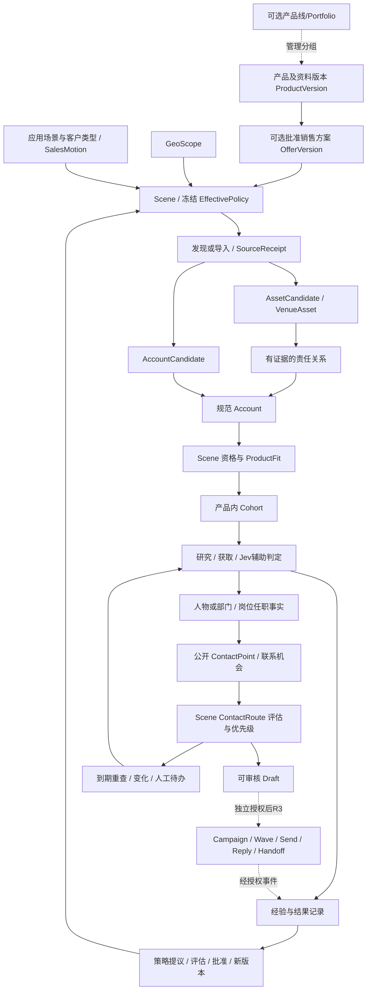

# 共享市场、产品资料与 Scene：统一业务模型

更新：2026-09-27。状态：**目标规格，待实现/复验，不是产品能力或销售资料真实性声明**。接续 [Member-A 自动化架构](MEMBER_A_AUTOMATION_ARCHITECTURE.md)，实施统一进入 [执行计划](MEMBER_A_AUTOMATION_EXECUTION_PLAN.md)，不新增一套平行 backlog。固定产品代码基线 `df689f52e0e07dc35b88af7a3a5dd48808008a75`，设计前身 `61419b7cd1b683da149a5b1e01d6c83829ed0816`，行为分析 `example-session-repo@06cdae471f794e37877637d69ea93d1c020272a2`。依据与新核对见 [研究说明](research/MARKET_MODEL_ACCESS_REVIEW_2026-09-27.md)。

## 1. 从原始目标开始，不从数据库表开始

真实任务是：在批准地区围绕一个业务研究目标，**逐轮发现、核实并积累**场地/资产、责任组织、相关人员/部门和公开联系路线，提供证据、可解释下一步，并在需要时结合产品资料做 ProductFit 或草稿。找到一个邮箱不是目标全部；把一次批次跑完也不是市场已覆盖，更不意味着某个国家“爬完了”。

Member-A 最少给出：本轮想研究什么、目标地区/对象/场景范围、期望结果、操作人与预算上限；产品/Offer 是按任务需要加入的可选上下文。系统从已有池子、策略和资料编译本轮计划，并展示缺项、冲突及将执行的动作；没批准的产品能力、预算、范围和外发权限不能由模型补齐。

本阶段 R1/R2 的结果是研究资产与草稿，不是已送达邮件、商机或收入。R3 的接口和事件定义在本文件保留，但真实发送、收件箱连接、飞书/CRM 外写另行启用。

## 2. 名词边界：产品线可选，Workstream/Scene 才是运行边界

| 概念 | 业务含义 | 不等于 |
|---|---|---|
| ProductLine 产品线（可选） | 面向管理/汇总的产品分类标签，可关联多个产品/Offer；**不是启动研究的必填对象** | 国家、任务、数据库、权限或后台进程 |
| Product / ProductVersion | 可识别产品及某一版本的已核实能力、限制、配置和资料 | 从名称推断出的能力 |
| Offer / OfferVersion | 本次准备向客户提供的具体产品版本/组合、用途、可用市场和批准主张；价格可缺省而不可编造 | 产品线本身或发送授权 |
| ApplicationScenario / Profile | 客户在什么业务环境做什么工作；描述需求、责任结构、来源类型和角色词表 | 单个物理场地或一个地名 |
| SalesMotion | 终端销售、维护承包商客户、渠道招募等商业关系 | 自动由组织名字推断的“客户/竞品”标签 |
| GeoScope | 有来源及版本的国家/行政区/覆盖多边形或地区集合，含排除区 | 只有自由文本 `Devon` 的搜索词 |
| Scene | 一个可独立批准、预算、暂停、统计和演进的市场经营任务 | 地区×产品所有组合的自动笛卡尔积 |
| Segment | Scene 内分析/策略细分，如机构类型、规模、维护模式、地区子集 | 新的授权边界或必需新 Scene |
| Cohort | 在某个时点按 selector 冻结的实际对象集合 | 产品线、母池总量或持续任务 |
| Run / WorkItem | 一次有边界的人机协同研究事务/子工作；读取已有池子并把可验证 Delta 合回共享事实库 | Scene 的长期业务身份、无限自动扩池 |
| Research pipeline 研究产线 | 可复用执行阶段和接口契约 | 每个产品线都部署一套爬虫和数据库 |
| Campaign / Wave | 未来针对指定目标、内容、阶段的触达活动/冻结批次 | 一条 ContactRoute 或创建 Scene 即授权发送 |

**Scene/Workstream 的划分标准是“执行与治理是否应独立”。** ProductLine 只有在确实需要产品负责人、汇总报表或组织分类时才维护；没有 ProductLine 也可直接引用 ProductVersion/Offer 开始研究。国家、语言、价格区间、模板差异不自动产生产品线。

例如“草坪划线”“草坪养护/割草”“测量/扫描”可以作为讨论用产品线候选，但不是本次对公司真实产品目录的批准分类，也不据此断言 EG10/Scanner 等型号的实际能力。批准资料和产品负责人决定最终归类。跨产品线组合归 Offer 引用，产品原件仍只维护一次；分析用标签/Portfolio 不复制产品主档。

## 3. 业务图：两种母池入口汇入同一 Account 主干



“母池”指来源候选集合，可以是场地、组织或两者；不是一律 VenueAsset。学校运动场可从场地进入，维护商、泳池搭建商、经销网络可从 Account 进入。Account-driven 任务不为填表捏造场地，不因没有 venue_id 就拒绝正常研究；需要证明某场地关系时才要求那个关系证据。

同一组织可以管理多场地，一个场地可有不同所有者/运营者/维护商/采购主体。一个抓取主机或一个 Asset 句柄不能永远决定组织身份。机构的经营地点、总部与实际负责资产的地区是不同事实；GeoScope 准入必须明确以哪种地点为准。

## 3.1 市场不是一次爬完：共享池靠每次 Run 增量生长

MarketOps 的核心资产是授权工作区里的共享 Market Graph，而不是某一次 CSV。任何 Workstream 都允许从“不完整但有证据的当前状态”开始；一次 Run 的目标是对一个**有限问题/有限对象集**产生可合并的变化，而不是声称穷尽互联网。

每个 Run 固定输入与策略版本，结束时必须给出可对账 `RunDelta`：

```text
RunDelta
- discovered_candidates
- promoted_assets/accounts
- responsibility_changes
- people/departments/role_assignments_added
- contact_points/routes_added_or_reassessed
- facts_superseded_or_withdrawn
- excluded / held / blocked / unchanged
- evidence/artifact refs
- action/review items created
- budget/usage/unknown usage
- next_recommendations
```

`RunDelta` 合入后，后续 Run **先读取并复用已有事实**，只补缺失、过期或本轮目标需要的部分。相同 Account/URL/证据在兼容权限和版本下不因换 session、换产品或换批次重复付费；场景评价可以分别重算。

“池子变大”不等于只增加行：纠错、撤回、冲突、历史化和 unchanged 都是合法增量。覆盖率如果没有可证明分母，只能报告“已发现/已核实/待研究”等可观测量，不能写“法国覆盖80%”或“该国已完成”。

## 3.2 三种执行模式：当前默认手动，自动化是显式可选

Workstream 存在不等于自动运行。执行模式与业务范围分开版本化：

| mode | 谁创建下一次 Run | 语义 | 当前定位 |
|---|---|---|---|
| `manual` | Member-A/获授权用户 | 用户明确启动一轮；**已受理 Run 内部**可自动续跑到终态，结束后不自行扩下一批 | **默认，也是当前真实试用模式** |
| `bounded_auto` | 服务在一份明确授权窗口内 | 可连续产生后续 Run，但受累计对象数/预算/截止时间/stop 条件约束 | 可实现/验收，不默认启用 |
| `watch` | due/event/schedule | 只对指定 View/对象/aspect 在到期或信号触发时产生维护 Run | 可配置，后续逐步启用 |

因此“客户端断开后继续”只代表**这一份已批准 Run 能完成**，不代表系统获得无限市场扩张授权。`manual` Run 结束时最多给 `next_recommendations`；只有 `bounded_auto`/`watch` 的有效授权记录才允许服务创建未来 Run。暂停、预算耗尽或需要人裁决都会阻止新的昂贵动作。

当前真实用户验收优先使用 `manual`：Member-A 自己在 Codex/WorkBuddy/MUC 选目标、看 preview、启动 Run、读 RunDelta、给反馈，再决定下一轮。自动化能力可以同时实现并用 fixture/受控时钟验收，但不是第一次真实任务成功的前提。

## 4. 如何启动研究：产品线不是前置门

### 4.1 ProductLine 只是可选登记，不会开始花钱

最小主档：`line_id, workspace, name, customer_problem, capability_family, owner, status, product_refs, approved_material_refs`。产品有一个明确维护归属；其他 Portfolio 只引用。不要求先建完整 PIM、价格引擎或制造业 BOM。

生命周期可为 `draft -> ready -> retired`；“是否正在经营”由已批准 launch/active Scene 投影，不维护互相打架的布尔值。产品归档停止创建新的 Offer，不删除历史结果。

### 4.2 启动的是 Workstream/Scene，不是产品线本身

启动顺序：

1. 登记/选择已批准 ProductVersion 与 OfferVersion；检查来源、适用市场、用途限制、claim 期限和负责人。资料不全可保存 draft，不可宣传未证实能力。
2. 选择 GeoScope、ScenarioProfile、客户类型与 SalesMotion，系统建议少量 Scene，并解释为何分/不分；不自动铺满所有国家×型号×行业。
3. 预览来源入口、准入/排除、角色策略、采集访问边界、资源需求、Cohort 计划、成本可观测范围和待批准缺项。
4. 获授权者批准具体 Scene、目标、研究预算与持续维护周期/累计上限，形成版本化 LaunchRecord；批准研究不产生外发授权。
5. 系统预检所需服务并持久受理 run/continuation。返回 launch/Scene/job id、实际排队状态、原因及何时会再次醒来；不能只把一个表字段改 active。

**算“启动成功”**：已批准的范围被服务持久受理、可回读，第一批有真实排队/派发证据；缺容量是 waiting，缺资料/鉴权是 blocked，配置完成不是已执行。重复同一请求回同一 launch，不重置预算。持续维护另有周期预算和总上限，不能每个小 run 自动续出无限额度。

暂停单个 Scene 不应停止其他 Scene。暂停产品线是明确的 scoped 操作，原子地增加 launch/run-control epoch 并阻止其后代的新昂贵动作；在途结果仍受理，全部传播有回执。恢复保持 checkpoint 和已花预算；恢复前再查产品撤回与授权。

最小用户体验：`准备 Devon 运动场负责人研究`直接得到范围/资料/预算/缺项预览；如确实有关联产品，再引用 ProductVersion/Offer；`批准并启动计划X`得到持久 Workstream/Scene id。ProductLine 可以不存在。`看进度/只暂停法国学校任务/取待审草稿`均通过同一 MCP。名称是用例意图，实际新增工具需同步 catalog/role/schema/tests，不在文档里伪称已注册。

## 5. Scene 怎样切：既不能太粗，也不能越细越好

Scene 的冻结绑定为：`workspace + geo_scope_ref + scenario_profile_ref + offer_version_ref + buyer/sales_motion + policy_refs + objective + owner + budget`。这是配置维度，不是由它们计算一个每次变化都新建的 Scene ID。一般地区×应用场景×Offer 已足够；只有商业关系/治理不同才增加独立单元。

| 变化 | 默认处理 | 需要新 Scene 的情况 |
|---|---|---|
| 同政策地区里的 Devon/Cornwall/Kent 分批 | Geo 子集 Segment/Cohort；共享 Scene 范围内筛选 | 地区有独立批准、团队、预算、政策或必须独立暂停 |
| 学校 vs 球场 vs 维护商 | 能共享执行与准入则 Segment + role/source overlay | 目标关系、准入、商业过程和责任人明显不同 |
| 同产品小版本、附件/文案修订 | Product/Offer/Policy 新版 + 影响预览 | 主导用途/销售动作根本改变且应独立经营 |
| 两个独立产品目标 | 默认不同 Offer/Scene，可共享同一 Account | 已批准的一体化组合方案有统一目标/预算时可同 Scene |
| 更换优先研究职位 | 更新 RolePriority policy/Segment override | 不因每个职位再造 Scene |
| 50户扩到下一50户 | 新 Cohort/Run | 不因批次、worker、聊天或日期再造 Scene |

判断：是否需要**独立批准/暂停/预算/业务目标**？若不需要，只是排序/语言或局部研究路径差异，优先 Segment/overlay。算法可以建议拆分，不能为少量回复噪声自动复制 Scene。父级共享事实和先验，子级证据不足不自信宣称独特模式。

跨国不是必定共享或必定拆分：默认按已批准政策区域执行，存在不同访问/外联边界时独立规则和授权。扩大原 GeoScope 是待批准新版本，不能用 Cohort 参数绕过。

## 6. 产品原始资料放哪里：来源、主档、运行快照分工

| 层 | 存什么 | 权威与安全 |
|---|---|---|
| 原始材料 SourceArtifact | 产品手册、规格、案例、官网快照、批准定价/图片等；原始字节+出处+版本/hash/日期 | 受管内容存储及 ACL；不把私有附件/客户数据自动推 Git；第三方 URL 不是永远不变的证据 |
| ProductVersion | 已核对能力、适用/不适用条件、单位、区域配置、来源定位与未知项 | 产品负责人批准；地区版不能偷偷继承无效 claim；同工作区只维护一份事实，跨租户不默认共享 |
| ApprovedClaim / ClaimRevision | 允许向外表达的一条主张，绑产品/变体/市场/语言/有效期及出处 | 复用当前 ApprovedClaim 并增作用域；批准来源是可信 principal，不取模型自填 |
| OfferVersion | 一个或多个已批准产品版本、用途、市场可用性、允许 claim | 无价格可照样研究；草稿不得生成猜价或规格 |
| Git authoring | 非敏感 schema、规则配置、公开/获准资料索引和测试样本 | 不是第二个运行态数据库；不把每个 Scene 复制一套产品资料 |
| 运行态 Store | 已发布版本、引用、批准、回滚/撤回、依赖关系 | 编译后 exact refs+hash 固定进 run/draft，不在运行中追 latest |

型号名字只能用于查目录；未知产品不能“自动初始化能力”后作为有效 Offer。旧 `product: str` 迁移走可核对 alias 映射，歧义进入 review/draft，不凭相似名字绑定。原始资料内容变更、科学性/真实性和营销允许说法是不同审批。

普通参数更新先重算 ProductFit/文案，只有缺失的事实才抓取；不是换产品名就全市场重爬。产品撤回/claim 撤销会使依赖的未发草稿 hold，并在后续动作前实时拦截；旧 run 的快照不能覆盖安全撤销，历史已发内容不可被改写。

## 7. 从“候选人”到“值得联系”的五个独立问题

| 层 | 要证明什么 | 不能混淆 |
|---|---|---|
| Account/Responsibility | 哪个组织负责哪些资产/采购/运营活动 | 官网可访问不等于采购责任 |
| PersonCandidate/Department | 公开材料是否明确指向同一人或部门 | 同名不跨机构自动合并；无姓名仍可有部门路线 |
| RoleAssignment | 此人/部门在该组织的原始职位、职责、时间与证据 | “主管”不是天然采购权，旧 staff PDF 不证明现职 |
| RoleFunction / AuthorityAssessment | 规范职能及在本产品场景中的实际相关性；采购/影响权为有证据或推断状态 | 事实职位、语义归类、权力推断分开，Jev 不是事实源 |
| ContactPoint + RouteAssessment | literal 邮箱属于谁、是否当前可用、Scene A/B/C/D/X与优先级 | 邮箱公开/格式正确不证明投递或回复；电话/表单是独立 Signal，不套邮箱等级 |

一个人可能有多个任职；一个部门邮箱可跨人员更替继续有效；两条职务关系不能因邮箱相同而合成一个人。原文 title、规范化 function、evidence strength、route grade、contact priority、推断购买影响力各有字段/来源。

“责任主管比总经理更值得联系”是可调整策略，而非任何场景的全局真理。终端购买、外包服务商购买、渠道招募各有角色矩阵；不能把 Member-A 某次“卖设备的是竞品”提升为全产品线对经销商永久硬排除。

## 8. 共享事实、按 Scene 经营，避免重复客户和相互打扰

工作区允许范围内复用：Asset、Account identity、官方域/路径声明、SourceArtifact、任职事实、literal ContactPoint。每个 Scene 单独计算准入、ProductFit、目标角色、route grade、priority、Cohort、草稿与结果归因。

当前 SOP 路线基础键仍为 `workspace/account/product_scene/normalized_email`；新增共享 ContactPoint 时保留每个 Scene 的 RouteAssessment 与兼容投影，不静默改变旧键语义。一个 Scene 里 A、另一个 Scene 里不相关可以同时成立。

原始工件可被多个获授权对象引用，但 workspace/Account 关联须有依据，不把 A 的 staff 证据绑定给 B。跨 Scene 请求共享同一未过期网页时可 single-flight：费用只结算一次，使用关系/分摊另记，不重复收费或重置预算。

R3 全工作区 contact/account 历史、suppression 与 owner/engagement 锁统一检查，不因产品线不同重复骚扰；商业授权可以仅允许单个 Campaign。已有销售接手不自动把所有其他产品都判成交，仅影响适用触达/owner 策略。R1/R2 可显示跨 Scene 已有结果，不启动额外外联。

## 9. Member-A 业务反馈如何反作用于 MarketOps，再到结果学习

MarketOps 首先学习 **Member-A 在使用过程里给出的业务反馈**，其次才是未来 R3 的回复/转介/demo 统计。反馈不能只存在聊天记忆；需要成为有来源、scope、影响和版本的服务端记录。R1/R2 现在即可学习来源收益、身份误绑、拒收原因、研究耗时、人工纠错、角色/页面优先经验和草稿事实性；真正职位回复/转介/demo 成果仍必须来自获授权且可对账的 R3 事件或批准导入历史数据。研究中 `Jev choice probability` 不是预测回复率。

建议统一 `FeedbackEvent`，至少包含 `principal/source_session, workspace, target_ref?, workstream_ref?, run_ref?, feedback_kind, literal_feedback/artifact_ref, proposed_scope, created_at`。系统再把它解释成不同处置，而不是把自然语言直接写成全局事实：

| feedback_kind | 典型例子 | 默认作用 |
|---|---|---|
| `fact_correction` | “这家公司其实是经销商，不是维护商” | 追加修订/反证，重评受影响对象；不自动泛化 |
| `run_instruction` | “这一轮先别找 Owner，继续看 Facilities” | 仅未来未派发的本 Run/后续 Run 计划；在途 attempt 保持冻结 |
| `workstream_policy` | “法国学校以后 Facilities 优先” | preview 影响后由 Member-A 批准为 Workstream/Segment policy 新版 |
| `experience_candidate` | “municipality/facilities 页最近比 contact 页有用” | 累积运行指标与样本，作为低/中风险 PolicyPatch 候选 |
| `business_definition` | “这类承包商今后算客户” | 可能改变资格/边界，必须可信业务批准，不由模型自发发布 |

反馈 scope 至少支持 `object/run/workstream/segment/scenario/geo/workspace`；不能只有 `global=true/false`。默认取**最窄合理 scope**，扩大 scope 需要影响预览或批准。所有生效策略有版本、来源和 rollback；历史 Run 保持其冻结策略，不被事后重写。

反馈有两条速度：**Fast loop** 让 Member-A 明确的当前/Workstream 级规则在预览后快速影响下一批；**Slow loop** 把重复出现的来源/角色/页面经验沉淀为 `ExperienceCandidate -> replay/evaluation -> PolicyPatch -> approval/promotion`。这样 Member-A 越用系统越懂业务，但“懂”是可追溯、可撤回、有 scope 的服务端知识，而不是某一个 Skill 或 session 私有记忆。

Outcome 记录至少绑定：workspace、Account、Scene/Segment、Offer/Product版本、RoleAssignment/function、路线/证据版本、模板/主张/CTA版本、实际分配策略、发送尝试/送达状态、发件箱/阶段/时间窗、回复/转介/demo类型、来源与人工标签。一次沉默不是自动拒绝；OOO/退信/退订不能算正面回应；provider accepted 不能冒充 confirmed delivery。

**不能用“谁 raw reply rate 高”直接改谁算核心角色。** 优先比较每个合格 Account 的有效正面回应/转介/demo与成本，并单独看投诉、退订、错误归属。标清观察窗口和重复对话去重；未知送达不得从分母静默丢掉；未回复但观察窗口未到属于未成熟结果。没有全市场 gold 不报告互联网 recall。

先分清地区、客户规模/类型、职能、模板、触达阶段、发件箱、季节和跟进强度。角色可能被旧策略挑选给最好客户，相关性不是角色造成的提升；小细分多看几次会随机出“冠军”。初期做分层描述与不确定性，足够数据后再评估分层/部分汇总模型；不为每个微 Scene 单独训练。

需要验证角色排序时：固定批准约束，按 Account/采购组织分组分配策略，避免同一组织不同人员互相污染；比较相同观察窗、记录样本量与置信区间、预先约定目标/护栏/停止规则。历史选择概率不明则不能把离线回放称因果验证；扩大/上线需要独立评估，不靠训练样本自评。

动态更新链：`Outcome/Correction -> ExperienceCandidate -> PolicyPatch -> replay/evaluation -> risk-appropriate approval -> new version -> monitor/rollback`。现有 Scene Evolution 复用，不新增“自我学习大平台”。

| 动态项 | 默认发布方式 |
|---|---|
| 已批准源内搜索顺序/已核实同义词/页面优先级 | 预批准的低风险边界内，回放门与预算/质量护栏通过后可自动；否则提议 |
| RolePriority、来源策略、研究充分性/模型阈值 | 先建议+比较，初期人工批准；只改排序不偷偷改资格/等级定义 |
| 新客户类别/地区、产品能力/claim、权限/抑制/发送政策 | 可信业务批准，不从回复率自动发布 |
| 客观事实纠错 | 追加修订与受影响对象重评，不覆盖历史、不默认发布全局规则 |

## 10. 可实现的最小 MCP 接入，不搞一堆新 CRUD

产品目录用例：登记资料引用/发布产品版本、查看可用 Offer、预览 launch、批准/启动限定 Scene、查看产品线/Scene概览。复用现有 create/update/activate/pause 工具，新增能力先 application，再类型化 MCP，普通 researcher 不具备发布/批准权限。

研究用例：列表/取证、按 Scene selector 建 Cohort、提交有界研究、读取任务/拒收/路线/草稿。人工用例：读 ReviewCase、按版本提交纠错/裁决。只读查看不付费探针、不触发下一批；启动/恢复/刷新是显式写操作，输入有幂等与预期版本。

启动前返回结构化 missing/invalid/awaiting_approval，不让模型读一段 traceback 猜。直接 Account 入口和场地入口都要经同一准入与业务用例；资料和启动缺一个环节时“页面存在”不算闭环。

## 11. 怎么证明比 Member-A 现有方式好

目标是**同等或更高可信质量下，用更少的人为搬运/催续跑、总用时和成本，得到可用业务结果**，不是无条件宣布“完美”。

比较固定场景/截止时间/样本与相同来源访问边界，盲化复核 Account identity、地区/场景、任职、邮箱绑定、草稿主张；从同一 gold 审核样本计算各类精度/遗漏/持有率及不确定性。独立评估者与开发调参人员分开，保留 hold/访问失败，不挑成功样本。

同时报告：每合格且核对正确的 Account/route 的总成本、人工主动分钟、重复付费、端到端 batch elapsed、worker-minutes、队列等待、重试/解析/审阅成本。并行不能把72个worker分钟称为72分钟用户等待；复用 warm/cold 两种条件分开。

技术 gate、受控可用 gate、对 Member-A 的 superiority 结论分开。比较质量非劣容限、最低质量要求和有意义效率改善由业务预先批准；测试通过不是已优于 Member-A。没有匹配基线/人工标签时 `not_demonstrated/unavailable`，允许小规模带复核使用，但不宣传效果已证。

所有声明/模型/数据/产品来源和作用范围均在上述固定基线下解释；实际实施后的验收必须绑新的 tested SHA，不从这份设计推导完成。