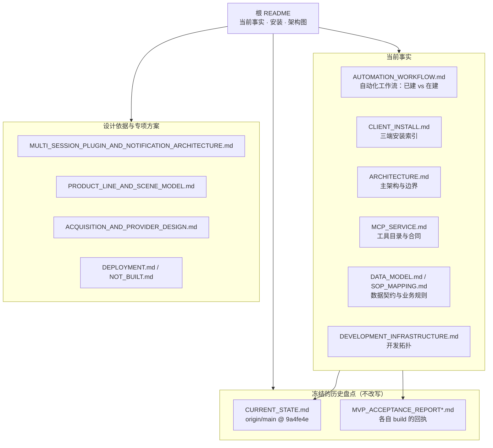

# docs/ —— 从这里开始

更新：2026-10-23。先分清四件事：**业务来源是什么、产品应当怎样工作、代码已经有什么、某次部署实际通过了什么**。它们不能用一份“当前状态”混在一起。

MarketOps 的对外交付形态收敛为 **一个可安装的 MarketOps 插件/主 Skill + 一个持久化业务 MCP**。Member-A 可从多个 Codex/WorkBuddy session 连接同一服务；任务、事实、Watch、Action、Schedule 与 Notification 都在服务端。客户端、供应商适配器和飞书投影都不是另一个业务后端。

## 文档地图



**读图规则**：箭头只表示「先看哪个」，不表示覆盖关系。冻结盘点里的事实只在它注明的
revision 上成立；今天的结论要么写在当前事实类文档里，要么以新构建的追加回执出现。

## 当前入口：Member-A 自动化设计与执行

先读 [主架构](ARCHITECTURE.md) → [插件/多Session/通知](MULTI_SESSION_PLUGIN_AND_NOTIFICATION_ARCHITECTURE.md) → [共享市场/Scene业务模型](PRODUCT_LINE_AND_SCENE_MODEL.md) → [采集与供应商接入](ACQUISITION_AND_PROVIDER_DESIGN.md) → [统一执行计划](MEMBER_A_AUTOMATION_EXECUTION_PLAN.md)。长期控制/数据机制见 [增量设计](MEMBER_A_AUTOMATION_ARCHITECTURE.md)，证据见 [2026-09-26](research/MEMBER_A_AUTOMATION_EVIDENCE_2026-09-26.md) 与 [2026-09-27](research/MARKET_MODEL_ACCESS_REVIEW_2026-09-27.md)。

本节记录的 `df689f52` / `06cdae4` 与「两份 PR 尚未合并」是 **2026-09-27 那个时点**的
状态。之后仓库已推进到 release candidate（插件版本见
`plugins/research-tools/marketops-research-assistant/.claude-plugin/plugin.json`）；
要判断当下，读该文件、`git log main` 与实际运行回执，不要拿本节当实时状态。
Jev 仍为 required，Laya/ServerOS/Docker/生产外联仍为 deferred。

以下保留专题导航；其中 2026-09-23 盘点只在原 revision 上成立。当前工具是核心研究目录与产品环目录的并集，不是总计只有 15 个。

## 1. 推荐阅读顺序

先读 [AUTOMATION_WORKFLOW.md](AUTOMATION_WORKFLOW.md)：它用一页说清「这条工作流今天能自动跑完
哪一段、还在建哪一段」，并指向每一项的关闭条件。**它不给完成百分比**，状态以本节 §B17/§B24/§B25
的关闭条件和 `B17_ACCEPTANCE_MATRIX_2026-09-28.md` 的逐行裁决为准。

1. [SOURCES.md](SOURCES.md)：原始档案、冻结快照与派生规格的权威关系。`upstream-records` 是长期档案；`sources/` 不改写历史字节。
2. [ARCHITECTURE.md](ARCHITECTURE.md)：**当前主架构入口**。一个 MCP、两类调用角色、资产/责任主体/联系人关系、Agent 与确定性程序分工、持久化和授权边界。
3. [MCP_SERVICE.md](MCP_SERVICE.md)：15 个核心研究工具的目录与行为合同；产品环扩展另见 MCP_PRODUCT_LOOP。当前发布门按本文上方入口。目录已在代码登记，不代表每个部署都已接线或通过实测。
4. [ARCHITECTURE_REVIEW_2026-09-23.md](ARCHITECTURE_REVIEW_2026-09-23.md)：结合 Member-C 聊天与源码的追溯审查。最重要的内容是输入生产链缺口、认证互操作、历史失败复验及逐项关闭条件。**§7 是它的收口对账**（E1–E10 逐格裁决），读 §4 的计划时应连着 §7 的读数一起读；§4 那张表本身不改。
5. [DATA_MODEL.md](DATA_MODEL.md)、[SOP_MAPPING.md](SOP_MAPPING.md) 与代码/测试：进一步核实数据契约及业务规则。目标字段或枚举存在，不等于已经有生产路径。

部署、历史运行与技术研究按下文选择，不必把全部历史迁移叙述读完才能理解产品。

## 2. 文档性质与冲突处理

| 类别 | 文件 | 应当怎样使用 |
|---|---|---|
| **A. 来源与可核对契约** | `SOURCES.md`、`SOP_MAPPING.md`、`DATA_MODEL.md` 的当前契约部分、代码导出的 `contracts/` | 来源决定业务口径；实现/Schema/测试决定当前可表达能力。每条“已接线”仍需对应调用路径 |
| **B. 冻结盘点/运行证据** | `CURRENT_STATE.md`、`MVP_ACCEPTANCE_REPORT.md`、`MVP_ACCEPTANCE_REPORT_2026-09-23_IMPLEMENTATION.md` | 只证明注明 revision/运行窗口内的事实；不把旧事实更新成今天的叙述。前者冻结，第三份是**某一构建**的回执 |
| **C. 当前架构与接口规格** | `ARCHITECTURE.md`、`MCP_SERVICE.md` | 按此收敛产品和实现；两者不是部署证书。核心研究与产品环目录并集与代码对照，未实现行为/缺口须保持显式 |
| **D. 专项方案与演进材料** | `DEPLOYMENT.md`、`PRODUCT_SPEC.md`、`ARCHITECTURE_DECISIONS.md`、`REQUIREMENTS_DISCOVERY.md`、`SCENE_EVOLUTION.md`、`POC_PLAN.md` | 按各自版本、状态和具体议题使用；不能从旧目标形态推出当前已实现能力 |
| **E. 有界审查/技术输入** | `ARCHITECTURE_REVIEW_2026-09-23.md`、`research/` | 审查提供代码/来源证据与建议；技术研究提供实现理由，不修改 SOP，也不代替实际验收 |

`DEVELOPMENT_INFRASTRUCTURE.md` 单独保留其已确认开发拓扑地位：Serper/Jev 与独立应用；共享 Laya 的拓扑约束保留，但本轮不启用、不作为发布门。它不是要求本次改生产服务的授权。`MVP_MIGRATION_PLAN.md` 的方案与逐阶段落地记录按各自日期阅读，不把历史记录汇总成一个永远最新的成功标志。

发生表面冲突时，先问是“业务授权”“目标设计”“当前代码”还是“某次运行”。业务仍以原始 SOP/获授权新来源为准；当前实现查代码和带 build 的回执。对于对外交付边界，2026-09-23 主架构明确以一个 MCP 收敛，不再要求另建 REST 业务 API、机器人平台或供应商 MCP。其他仍待确认的产品默认值，不因这次收敛就自动全部批准。

### 不改历史盘点是明确决定

`CURRENT_STATE.md` 冻结在 `origin/main @ 9a4fe4e` 的 Phase A 起点，里面的旧目录和行号只在对应 revision 上有意义。它写“库 + CLI”不能被引用来描述今天已有 MCP 的代码；但也不应去改它的行号或结论。看当前结构请读根 `README.md` 的目录、下文 §3 和源码。

`MVP_ACCEPTANCE_REPORT.md` 的主要验收 B 运行在 `9ef5ba4`，保留并发、隔离和判定落盘等未通过项，另有明确标记的补记。修复后应追加新构建/新运行回执，不能把旧 FAIL 改成 PASS。本轮架构审查没有运行新验收。

2026-09-23 的复验回执追加在 [MVP_ACCEPTANCE_REPORT_2026-09-23_IMPLEMENTATION.md](MVP_ACCEPTANCE_REPORT_2026-09-23_IMPLEMENTATION.md)，build 为 `168d69b`，A–E 五节逐项给出 PASS / FAIL / BLOCKED / NOT_RUN 与可重跑的读数。**旧文件一个字节都没改**；两者并存，旧 FAIL 仍然是旧 FAIL。

## 3. 当前目录与职责

根 `README.md` 的目录与下表用于定位当前代码；旧迁移方案里的目标树、Phase A 盘点不是当前路径索引。

```text
marketops/          唯一 Python 分发包
  domain/           纯领域：实体、值对象、业务不变量
  application/      用例：输入、发现、准入、预算、派发、证据与报告
  ports/            search / acquisition / documents / store / budget / jobs / dispatch / decisions
  adapters/         Serper / HTTP / Crawl4AI / PDF / Jev / Laya / local_board / SQLite / JSONL / Feishu / MCP
  interfaces/       CLI、MCP 入口与组合根；构造和注入具体依赖
  security/         tokens / catalog / network 等权限与访问边界
  config.py         唯一配置入口
  schema.py         contracts 导出者
contracts/          从模型导出的 JSON Schema，单向生成，不手写修改
profiles/<scene>/   从业务来源编译出的 profile / grading / role-matrix
sources/            业务原始材料逐字节冻结快照；遵循追加/来源校验规则
 tests/             自动验证（实际目录为仓库根 tests/）
deploy/             部署相关材料
docs/               规格、审查、历史证据与技术研究
```

MCP 主入口在 `marketops/interfaces/mcp/`，服务组装与协议处理在 `marketops/adapters/mcp_server/`。已有两类角色目录不等于已完成多租户对象隔离；共享部署的限制和验收要求见主架构 §9。

## 4. 各专题说明

### 业务与数据

[SOP_MAPPING.md](SOP_MAPPING.md) 把人工流程映射到能力，区分规则已装载与路径已接线。[DATA_MODEL.md](DATA_MODEL.md) 的 §0 是目标扩展，§1 之后描述当前契约；阅读时仍需核对当前代码。[PRODUCT_SPEC.md](PRODUCT_SPEC.md) 保留完整产品与研究 milestone 的业务分界，其早期实现盘点和未获得业务背景的说法不代表本轮阅读后的结论。Member-C 补充了哪些背景、哪些仍未取得，见本次审查 §1–2。

[REQUIREMENTS_DISCOVERY.md](REQUIREMENTS_DISCOVERY.md) 与 [SCENE_EVOLUTION.md](SCENE_EVOLUTION.md) 是专项发现/演进材料。[ARCHITECTURE_DECISIONS.md](ARCHITECTURE_DECISIONS.md) 的推荐默认值按其待确认状态处理；本次单 MCP 收敛不等于自动授权新的产品场景或外部动作。[POC_PLAN.md](POC_PLAN.md) 是研究阶段 POC 计划。

### 实现与部署

[MVP_MIGRATION_PLAN.md](MVP_MIGRATION_PLAN.md) 提供阶段落点、偏离及相关测试/运行记录，应沿时间和 revision 追溯。[DEPLOYMENT.md](DEPLOYMENT.md) 描述部署方案，不因为文档存在就已有相应进程。[DEVELOPMENT_INFRASTRUCTURE.md](DEVELOPMENT_INFRASTRUCTURE.md) 规定已确认开发拓扑，应用/runner 容器化与生产 Hosting 改动仍不属于这次任务。

[NOT_BUILT.md](NOT_BUILT.md) 解释刻意不建的独立 API 服务/飞书机器人及相关约束。它不表示当前 MCP 服务不存在；“飞书对话经 Hosting 使用 MCP”和“FeishuSink 写表”必须分开判断。

### 历史事实

[CURRENT_STATE.md](CURRENT_STATE.md) 与 [MVP_ACCEPTANCE_REPORT.md](MVP_ACCEPTANCE_REPORT.md) 保持冻结。前者回答起点，后者回答特定运行实际发生了什么，包括失败。后续可引用其失败设计回归测试，但不能拿本轮文档工作替代新运行证据。

### 最新审查与研究

[ARCHITECTURE_REVIEW_2026-09-23.md](ARCHITECTURE_REVIEW_2026-09-23.md) 记录本轮静态审查基线、Member-C message_id、实现缺口和 E1–E10 关闭条件。它是有界审查和建议，不是新的运行报告；后续实施进度应附实际 commit/测试/回执，不静默改写本次观察。§7 就是这条要求的样子：计划表原样留着，收口另起一节，逐格给裁决与读数。

[research/MCP_RELIABILITY_REVIEW_2026-09-23.md](research/MCP_RELIABILITY_REVIEW_2026-09-23.md) 记录本轮 SciSpace 检索、一手摘要核对和版本化 MCP 资料，说明采用的工程推论及限制。

[research/MARKETOPS_V1_ARCHITECTURE_RESEARCH_2026-09-20.md](research/MARKETOPS_V1_ARCHITECTURE_RESEARCH_2026-09-20.md) 保留 V1 技术研究基线。研究可以改变实现选择，不能改变 SOP 的业务授权、排除和 literal 邮箱规则。
