# MarketOps V1 产品架构与实现路线深度研究

日期：2026-09-20  
状态：技术研究基线，供 V1 实施与 benchmark 使用  
业务 Source of Truth：Member-A / Member-D / party-group 三人群 + 《英国天然草坪｜AcmeCorp Pro｜自动调研、开发信与有效回复监控 SOP v1》

## 1. 执行结论

MarketOps 的业务目标不是“做一个爬虫”，也不是“做一个万能 Agent”，而是把下面这条链路做成可恢复、可审计、可参数化复用的系统：

```text
Target Asset / Venue
  -> Responsible Entity / Account
  -> Relevant Person / Role
  -> Literal Public Business Email
  -> Evidence
  -> A/B/C/D/X Route
  -> Authorized Outreach
  -> Reply / Suppression / Sales Handoff
```

当前最值得优先解决的是 Research 段，而不是发送段。

历史英国链已经证明：
- 直爬吞吐已经不是首要问题；
- 真正瓶颈是“页面是否被发现”“责任实体/人/邮箱是否正确绑定”“失败是否可解释”；
- Search Discovery、Evidence Binding、False Attribution 控制比继续压 domains/min 更重要。

### 推荐总体路线

```text
P0  Serper + deterministic Python baseline
      |
P1  Claude Code / DeepSeek Harness
    通过同一组 MCP tools 做 planner/orchestrator A/B
      |
P2  Raw Playwright
    仅处理 JS_REQUIRED / EMPTY_SHELL
      |
P2.5 Crawl4AI
    与 raw Playwright 做 BrowserFetcher ROI 对比
      |
P3  MinerU
    仅处理 lightweight parser 无法恢复的复杂/扫描 PDF
```

第一原则：

> LLM/Agent 可以决定“下一步研究什么”，但不能决定“事实是否存在”。

最终进入 Contact/Evidence 主表的事实必须能通过：

```text
query
-> public URL
-> fetched mirror
-> content hash
-> evidence locator
-> literal email
-> deterministic binding / validation
```

重新得到。

---

## 2. SOP 对产品的直接要求

SOP 明确规定 Research 只允许：
- 公开网页；
- 公开 PDF；
- 公开 API；
- 合法公开数据。

禁止：
- 登录目标网站；
- 抓私有页面；
- 绕过访问限制 / access control；
- 提交表单换取内容；
- 猜测或生成邮箱；
- 购买邮箱；
- SMTP probing / verification。

每条邮箱必须来自本地镜像中实际出现的 literal 文本，并保留：
- account_id；
- entity/person/role；
- source_url / final_url；
- evidence_text / record block；
- fetched_at；
- content_type；
- SHA-256；
- mirror path；
- grading profile/version。

发送和 Research 必须严格隔离。Research 阶段始终保持：

```text
research_only=true
send_authorized=false
```

SOP 原文来源：
- upstream-records: `information/raw/feishu/chats/groups/party-group/oc_00000000000000000000000000000004/links/docx-research-outreach-sop/content.md`
- 三人群消息：`information/raw/feishu/chats/groups/party-group/oc_00000000000000000000000000000004/messages.jsonl`

---

## 3. 推荐产品架构

```mermaid
flowchart LR
    PROFILE["Versioned Profile<br/>eligibility / exclusions / roles / grading"]
    ACCOUNT["Known Account / Entity / Venue"]
    SEARCH["SearchProvider<br/>Serper"]
    HITS["Candidate URL Ledger"]
    HTTP["HttpFetcher<br/>HTTPX"]
    FOUT{"Fetch Outcome"}
    BROWSER["BrowserFetcher<br/>Raw Playwright<br/>later Crawl4AI candidate"]
    BLOCK["blocked / no_route"]
    ROUTER{"Document Router"}
    HTML["HTML Parser"]
    PDF["Lightweight PDF Parser"]
    MINERU["MinerU fallback"]
    EXTRACT["Literal Email / Name / Role Extraction"]
    AGENT["Optional Research Planner<br/>Claude Code / DSH"]
    VALIDATE["Deterministic Binder / Validator"]
    GRADE["A/B/C/D/X Grading"]
    STORE["Evidence Store / Audit Ledger"]
    FEISHU["Feishu Control Plane"]
    OUTREACH["Future: Wave / Authorization / Send"]
    REPLY["Future: Reply Monitor / Sales Handoff"]

    PROFILE --> SEARCH
    ACCOUNT --> SEARCH
    SEARCH --> HITS
    HITS --> HTTP
    HTTP --> FOUT
    FOUT -->|OK| ROUTER
    FOUT -->|JS_REQUIRED / EMPTY_SHELL| BROWSER
    FOUT -->|BLOCKED / WAF / login / 404 terminal| BLOCK
    BROWSER --> ROUTER
    ROUTER --> HTML
    ROUTER --> PDF
    PDF -->|low quality only| MINERU
    HTML --> EXTRACT
    PDF --> EXTRACT
    MINERU --> EXTRACT

    HITS -. planning context .-> AGENT
    EXTRACT -. candidate evidence .-> AGENT
    AGENT -->|proposal only| VALIDATE
    EXTRACT --> VALIDATE
    PROFILE --> GRADE
    VALIDATE --> GRADE
    GRADE --> STORE
    STORE --> FEISHU
    STORE -. later .-> OUTREACH
    OUTREACH -. explicit authorization .-> REPLY
```



### 关键边界

**Production core：**
```text
Python -> SearchProvider / Fetcher / Parser / Validator / EvidenceStore
```

**Agent experiments：**
```text
Claude Code / DSH -> MCP -> 同一组底层能力
```

Production core 不应该为了调用自己的 Python 能力再绕 MCP 一圈。

---

## 4. MCP 在哪里最合适

MCP 应该是 Agent interoperability layer，不是 MarketOps 的业务核心。

推荐第一版只暴露窄工具：

```text
get_account_context(account_id)
search_serper(account_id, template_id, variables)
list_candidate_urls(account_id)
fetch_public_url(account_id, url)
read_document(fetch_id, locator?)
submit_route_candidate(account_id, evidence_ids, person, role, email)
finish_account(account_id, reason)
```

不暴露：

```text
shell(command)
browser_open(any_url)
login(...)
send_email(...)
smtp_probe(...)
set_proxy(...)
solve_captcha(...)
bypass_waf(...)
```

这样 Claude Code、DeepSeek Harness、未来其他 runner 都能用同一套工具公平 benchmark。

---

## 5. Search：V1 先选 Serper

### 为什么现在先 Serper

当前未知量不是“我们会不会 HTTP GET”，而是：

> Google 索引里是否存在大量现有 crawler 从未发现的 staff / facilities / council PDF / project / meeting pages？

因此第一阶段应先隔离 Search Discovery 变量。

建议 query grammar 版本化：

| template | 示例 | 用途 |
|---|---|---|
| role_official | `site:{domain} "grounds manager"` | Grounds 核心角色 |
| turf_pitch | `site:{domain} ("sports turf" OR "pitch manager")` | Turf/Pitch |
| facilities | `site:{domain} (facilities OR estates OR maintenance)` | Facilities/Estates |
| ops_procurement | `site:{domain} (operations OR procurement OR "venue manager")` | 运营/采购 |
| pdf_role | `site:{domain} filetype:pdf (grounds OR facilities OR maintenance)` | PDF / minutes / directory |
| domain_email | `site:{domain} "@{domain}" (grounds OR facilities OR estates)` | 发现含域名邮箱的页面 |
| named_account | `"{account_name}" "{location}" "grounds manager"` | 域名线索弱时 |
| venue_entity | `"{venue_name}" "{responsible_entity}" facilities` | Venue -> Entity |

注意：SERP snippet 中出现邮箱不能直接成为 Contact。必须 fetch 目标 URL，并从镜像里再次找到 literal email。

### 初始预算

```yaml
search_budget:
  max_queries_per_account: 8
  results_per_query: 10
  early_stop:
    - ">= 2 validated A/B routes"
    - "query budget exhausted"
```

Agent runner 也必须用相同 budget，否则实验不公平。

### 其他 Search Provider

DataForSEO / SerpAPI / Brave / Firecrawl Search 应保持为可替换 SearchProvider 候选，但 V1 不同时接多个 provider。先用 Serper 建基线，再用真实 cost/new-A/B 数据决定是否换 provider。

---

## 6. Acquisition：HTTP first，Browser strict fallback

推荐状态机：

```text
Serper URL
 -> HTTPX GET
    -> 200 usable HTML/PDF     -> parse
    -> 200 empty/JS shell      -> browser eligible
    -> explicit JS required    -> browser eligible
    -> timeout/network error   -> bounded retry -> fail
    -> 404/410                 -> terminal
    -> 401/login/private       -> terminal BLOCKED
    -> 403/WAF/challenge       -> terminal BLOCKED
    -> target-site 429         -> backoff / terminal
```

不要写成：

```text
403 -> Playwright
```

明确 WAF / access-control / login / paywall 不应该进入“绕过实验”。

### Raw Playwright 先于 Crawl4AI

先测：

```text
HTTPX -> only JS_REQUIRED/EMPTY_SHELL -> Raw Playwright
```

原因是这能单独回答：

> “真实浏览器渲染本身有没有业务增量？”

只有 raw Playwright 证明有 ROI 后，再让 Crawl4AI 与它竞争 BrowserFetcher。

### Crawl4AI 的角色

Crawl4AI 是 Browser/Extraction framework candidate，不是 Search Provider，也不是 SOP 边界的例外。

建议：
- optional dependency；
- 固定版本；
- 隔离运行；
- 限制 URL/redirect/private network；
- 限制下载体积 / PDF pages / wall-time；
- 不暴露 stealth/CAPTCHA/WAF bypass 能力给 MarketOps。

业务接口保持：

```python
class BrowserFetcher(Protocol):
    async def fetch(self, request: FetchRequest) -> FetchResult:
        ...
```

候选实现：

```text
PlaywrightBrowserFetcher
Crawl4AIBrowserFetcher
```

---

## 7. PDF / MinerU

默认：

```text
HTML -> BeautifulSoup / structural blocks
PDF  -> lightweight parser (pypdf / PyMuPDF-class fast path)
```

只有出现以下情况才升级 MinerU：
- 几乎无可提取文本；
- 扫描件；
- 多栏阅读顺序严重错误；
- table/block 关系丢失；
- lightweight parser error；
- parse-quality gate 低于阈值。

不要：

```text
所有 PDF -> MinerU
```

而应该：

```text
所有 PDF -> lightweight parser
                  |
                  +-> failure / low-quality only -> MinerU
```

MinerU 是否进入默认 fallback，必须由“困难 PDF 中恢复了多少 name/role/literal-email evidence”决定，而不是 OCR 字数决定。

---

## 8. Agent 到底负责什么

Agent 只负责模糊研究决策：

- 下一条 query 应该选哪个 template；
- 哪个 SERP URL 值得优先抓；
- 当前 Account 是否需要继续搜索；
- 哪个 evidence block 可能对应某个人/岗位；
- 是否值得消耗剩余 query budget；
- 提议 person/role/email/entity 绑定；
- 提议 A/B/C/D/X；
- 给 review 解释原因。

确定性代码负责：

- API 调用 / retry / rate limit；
- URL canonicalize / dedupe；
- fetch / blocked classification；
- mirror / SHA-256 / timestamp；
- literal email extraction；
- final evidence binding；
- grading rules；
- append-only audit；
- suppression / authorization / send gates。

Agent 永远不能直接把“猜测”写成事实。

---

## 9. Evidence / 数据模型

产品不是“邮箱列表”，而是维护：

```text
Venue / Asset
 -> Responsible Entity / Account
 -> Person / Role
 -> ContactRoute
 -> Evidence
```

建议核心实体：

```text
ResearchJob
Profile
Source
VenueAsset
Account / ResponsibleEntity
Person
Role
SearchQuery
SearchHit
FetchAttempt
Document
EvidenceSpan
RouteCandidate
RouteEvidence
GradeDecision
AuditEvent

Future:
Wave
RecipientManifest
Suppression
SendEvent
ReplyEvent
SalesHandoff
```

尤其必须把 Venue 与 Responsible Entity 分开。

同一个 Council / Trust 可以管理多个 Venue；同一个 Person 也可能覆盖多个 Venue。

---

## 10. Evidence Store

V1 无需先上复杂数据库集群。

建议：

```text
immutable mirrors/
+
append-only evidence JSONL
+
SQLite query projection
```

每个 route 至少可追溯：
- 哪个 run；
- 哪个 account/entity；
- 哪个 query；
- SERP rank；
- 哪个 URL；
- 哪次 fetch；
- 哪个 document hash；
- 哪个 DOM/PDF locator；
- literal email；
- binder/grading version；
- runner/model/prompt hash；
- revision history。

目标是能回答：

> 不相信 Agent，只根据 query -> mirror -> evidence -> rule，能否 replay 出同样结论？

---

## 11. Feishu 产品形态

Feishu 适合作为 Control Plane / Business UI，而不是 crawler backend。

建议显示：
- Campaign/Profile；
- Accounts；
- Research Jobs；
- A/B/C/D route；
- Evidence；
- blocked/no_route；
- benchmark/KPI；
- future wave authorization；
- reply/sales handoff。

人类只应该在少数高价值节点介入：
- Profile/策略批准；
- ambiguous evidence；
- campaign/wave authorization；
- reply handoff 中模糊回复；
- policy/safety exception。

不应该让人逐页面审批 crawler。

---

## 12. Benchmark 设计

### Stage 1 — 30-account deterministic pilot

样本：官网可正常访问，但当前没有核心角色邮箱。

目标：只测 Search Discovery。

```text
Account
 -> Serper
 -> HTTPX
 -> HTML/pypdf
 -> literal email
 -> evidence binding
 -> A/B/C/D/X
```

暂时不加 Browser/Crawl4AI/MinerU/Agent。

### Stage 2 — 100-account paired benchmark

同一批 Account 分别跑：

```text
A. Python deterministic baseline
B. Claude Code
C. DeepSeek Harness
```

三者共享：
- 同一个 Account/Profile；
- 同一个 Serper；
- 同一个 Fetcher；
- 同一个 Parser；
- 同一个 Validator；
- 同样 query budget；
- 同样 URL budget；
- 同样 timeout。

唯一变量：Research Planner / Orchestration。

建议做两个实验：

1. 固定 Serper response，比较 URL prioritization / reasoning；
2. 允许 runner 自己选 query，但每 account 最多 8 queries。

### Stage 3 — Browser cohort

只从真实：
- JS_REQUIRED；
- EMPTY_SHELL；
- RENDER_FAILURE；

抽样。

不包括明确：
- WAF/403 challenge；
- login/private；
- paywall。

比较：

```text
HTTP only
vs
HTTP + raw Playwright
vs
HTTP + Crawl4AI
```

### Stage 4 — Difficult PDF cohort

收集 lightweight parser 失败的真实 PDF，再测 MinerU。

---

## 13. KPI

主指标：

```text
net-new A/B per 100 accounts
```

同时记录：

```text
accounts_with_new_ab_rate
literal_emails
net_new_cd_per_100
false_attribution_rate
evidence_completeness
pages_per_ab
queries_per_ab
cost_per_ab
time_per_account
human_review_rate
browser_recovery_rate
parse_recovery_rate
LLM tokens
browser seconds
```

特别强调：
- false attribution 必须是硬质量指标；
- evidence completeness 对 A/B 应为 100%；
- 不再把 domains/min 当主要业务 KPI。

---

## 14. 建议实验 Gate

这些是工程实验阈值，不是 SOP 原文。

### 30-account smoke gate

```text
0 safety boundary violations
100% A/B have URL + hash + evidence locator
0 known cross-account false attribution
>= 3 net-new A/B
run supports checkpoint/replay
```

### 100-account Serper gate

建议继续扩大条件：

```text
net-new A/B >= 10 / 100 accounts
false attribution <= 1%
A/B evidence completeness = 100%
human review <= 25%
```

### Agent adoption gate

Claude / DSH 只有满足以下之一才值得进入默认 Research：

```text
vs deterministic:
relative A/B uplift >= 20%
OR
absolute uplift >= 5 A/B / 100 accounts
```

同时：
- false attribution 不恶化；
- human-review 增加 <= 10 percentage points；
- incremental A/B 的额外模型/API 成本必须可接受。

---

## 15. V1 / V1.5 / V2

### V1-A — Research Engine

实现：
- SOP -> versioned profile；
- Account/Venue/Entity model；
- Serper QueryPlanner；
- deterministic Search/Fetch/Parse/Evidence/Grade；
- checkpoint / receipt / audit；
- benchmark metrics；
- Feishu research projection（可后接）。

### V1-B — Agent comparison / MCP

实现：
- 窄 MCP gateway；
- Claude Code runner；
- DeepSeek Harness runner；
- 100-account paired benchmark。

### V1.5 — Browser / Complex docs

实现：
- raw Playwright；
- Crawl4AI comparison；
- MinerU difficult-PDF fallback；
- 只在 benchmark 证明 ROI 后进入默认 pipeline。

### V2 — Outreach + Replies

Research 通过大样本验收后才实现：
- wave candidate；
- historical dedupe；
- suppression；
- immutable recipient manifest；
- explicit authorization；
- send stage 1-4；
- reply monitor；
- unsubscribe/bounce/OOO；
- effective reply -> sales handoff。

---

## 16. 第一周实施顺序

1. **把 SOP 真正编译成 Profile**
   - asset eligibility；
   - hard exclusions；
   - role matrix；
   - P1/P2/P3/P4；
   - A/B/C/D/X；
   - tests。

2. **冻结第一批真实 30 Accounts**
   - 官网可访问；
   - 当前无核心角色邮箱；
   - 符合英国天然草坪场景；
   - 不含 golf/artificial/indoor/MUGA 等硬排除。

3. **实现 QueryPlanner + Serper baseline**
   - versioned query grammar；
   - max 8 queries/account；
   - raw search response archive；
   - URL canonicalize/dedupe；
   - early stop。

4. **跑 deterministic end-to-end**
   - Serper -> HTTPX -> HTML/pypdf -> literal email -> evidence -> grade；
   - 先不装 Crawl4AI/MinerU；
   - 先不接 Agent。

5. **输出 benchmark**
   - A/B/100；
   - false attribution；
   - evidence completeness；
   - queries/account；
   - pages/A-B；
   - cost/time。

6. 30-account gate 通过后，再实现 MCP + Claude/DSH runner。

---

## 17. 现在明确不要做什么

当前不要：
- 恢复旧英国生产链；
- 发任何客户邮件；
- 开启 reply monitor；
- 一次同时接 Serper + Claude + DSH + Crawl4AI + MinerU；
- 让 Agent 自由 shell / browser / proxy；
- 把 403 自动升级成 browser/WAF bypass；
- 登录目标站点；
- 从 SERP snippet 直接采信邮箱；
- 让 Agent 直接写入最终事实层；
- 所有 PDF 默认跑 MinerU；
- 用 domains/min 代替业务 KPI。

---

## 18. 最终架构判断

MarketOps 应该是：

```text
Deterministic Product Core
    +
Narrow Tool API / MCP Facade
    +
Replaceable Agent Planner
    +
Feishu Control Plane
```

而不是：

```text
Universal Agent
 -> browser everywhere
 -> LLM decides everything
 -> writes contacts directly
```

核心产品价值是：

> 低人工、低 token、可审计地持续产生正确的 A/B 联系路线，并在未来经过授权后把这些路线转成外联和有效回复。

---

## 19. 技术资料

外部技术资料只能支持“怎么实现”，不能改写业务边界。

主要参考：
- Serper: https://serper.dev/
- Playwright Python: https://playwright.dev/python/
- Crawl4AI: https://github.com/unclecode/crawl4ai
- MinerU: https://github.com/opendatalab/MinerU
- Claude Code MCP: https://docs.anthropic.com/en/docs/claude-code/mcp
- DeepSeek API / Agent integrations: https://api-docs.deepseek.com/
- UK ICO B2B direct marketing guidance: https://ico.org.uk/for-organisations/direct-marketing-and-privacy-and-electronic-communications/business-to-business-marketing/

## 20. 业务事实来源

MarketOps 的业务 Source of Truth 只允许来自：
1. Member-A 私聊；
2. Member-D 私聊；
3. Member-A/Member-B/Member-D 三人群及其 SOP。

原始资料保存在 `ProfessorZhi/upstream-records`；MarketOps 仓库中的 Product Spec / Profile / Architecture 都只是从这些原始资料派生出的 projection。
