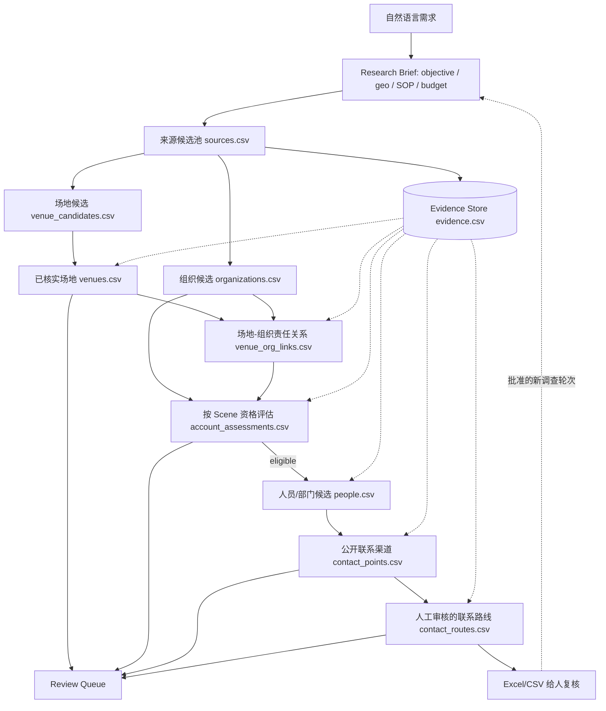

# Research Pack v0.2 — 信息流与字段合同

这个合同服务**本地半自动研究交接**，不替代 MarketOps 已有的 Account/VenueAsset/EvidenceStore/ContactRoute 数据模型。由人和 Agent 协作输出的 CSV 经确认后，未来只能通过受管导入写入真正 MarketOps 数据库。

## 1. 两条并行的信息流

**证据是并行数据层**。没有其支撑，不得从 discovered 晋升 verified、从候选邮箱晋升正式 ContactRoute；`contact_routes.status=ready` 是**研究可交付**，不是“允许发信”。

## 2. 表格分工与主键

| 文件 | 主键 | 核心用途 | 对应现实对象 |
| --- | --- | --- | --- |
| `sources.csv` | `source_id` | 查询来源/URL、搜索与地图线索 | 数据源，不是公司事实 |
| `evidence.csv` | `evidence_id` | URL、原文摘要、实际页面 SHA-256、时间与质量 | 支持具体事实 |
| `venue_candidates.csv` | `candidate_id` | 未核实或 HOLD 的场地线索 | 候选场地 |
| `venues.csv` | `venue_id` | 已验证场地及其 candidate 血统 | 真实资产/场馆 |
| `organizations.csv` | `organization_id` | 组织身份和经核实官网；也可独立于场地存在 | 客户、运营者、维护商、经销商 |
| `venue_org_links.csv` | `link_id` | owner / operator / maintainer / procurement 关系 | 有证据的责任关系 |
| `account_assessments.csv` | `assessment_id` | 按 Scene 的 eligible / hold / irrelevant / duplicate | **业务评价，不是永久组织属性** |
| `people.csv` | `person_id` | 姓名/部门、所属组织、现时职务与来源 | PersonCandidate / Department |
| `contact_points.csv` | `point_id` | 字面公开邮箱/电话/网页表单等原始触点 | ContactSignal / ContactPoint |
| `contact_routes.csv` | `route_id` | 组织+职能+邮件触点+证据+审核结果 | ContactRoute A/B/C/D/X |
| `review_queue.csv` | `review_id` | 所有未知、冲突、需要人工决策的对象 | HUMAN_REVIEW |

本例仅保留最小字段；`research_pack.py` 中的 `TABLES` 是**本离线数据包字段顺序唯一权威**，Excel 导出不可擅自重命名字段。所有对象键是工作区内稳定的、明确分配的 ID，**不得**靠 URL hostname 或人名推导实体唯一性。

## 3. 引用关系

- `evidence.source_id → sources.source_id`。
- `venue_candidates.source_id → sources.source_id`，`venues.candidate_id → venue_candidates.candidate_id`。
- `venues.evidence_id`、`organizations.evidence_id`、`venue_org_links.evidence_id`、`account_assessments.evidence_id`、`people.evidence_id`、`contact_points.evidence_id` 和 `contact_routes.evidence_id` 均引用 `evidence.evidence_id`。
- `venue_org_links` 显式把一个场地关联到一个组织及责任类型。
- `people.organization_id` 和 `contact_points.organization_id` 引用 `organizations.organization_id`。一个人/部门可有多个触点；一个部门触点可以不指名具体人。
- `contact_routes` 绑定 `organization_id`、`scene`、`point_id`，可选 `person_id`。`ready` 前必须已有该 Scene 的 `eligible` 资格判断、字面可验证的公开邮件与人工 `reviewed_by`。

## 4. 各阶段晋升

| 从 | 到 | 必须满足 |
| --- | --- | --- |
| source_hit | venue_candidate | 来源/地区/实体可能成立，保留 `discovered` |
| venue_candidate | verified venue | 来源正文被读取，证据 `usable`、可确认场地身份 |
| organization discovered | organization verified | 官网/权威来源证明身份；域名不是凭外观推断 |
| venue + organization | verified relation | 有明确 owner/operator/maintainer/procurement 关系证据 |
| organization | eligible | 当前 Scene SOP 可求值，证据足以支持业务条件 |
| role candidate | person verified | 人/部门、组织、岗位/任职及时间足以互相归属 |
| contact point discovered | contact point verified | 原文里真实出现邮箱，已对准组织/人或部门 |
| contact point | ready route | 按 Scene 独立 A/B/C/D 等级、证据可用、人核验、无冲突 |

`source`、`evidence`、`relationship` 和 `scene_assessment` 可随研究阶段反复新增。**不要把它们误画成只有一个方向的一次性阶段表。**

## 5. 人机分工与安全

- Agent：搜索、网页阅读、整理实体、提示矛盾、提议等级、制作工作簿。
- 程序：字段形状、主键唯一、外键引用、状态组合、实际证据存在性、单一版本清单、阻塞规则。
- 人：目标客户定义、SOP 裁决、费用和新增地域批准、复杂责任归属、正式联系人审核；未来外联单独审批。
- 不收集或推断非必要私人联系信息；拒绝将验证码、权限墙或纯搜索摘要当成证据；不自动发信。

## 6. 运行结束的真实含义

`research_pack.py summary` 统计**当前文件中实际行数和各状态**，不是“抓取覆盖率”或“任务已验收”。半自动先用单写者交接；并发多人使用必须换成 MarketOps 授权数据库。