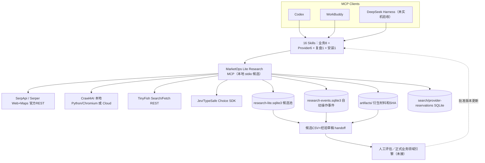

# MarketOps Research Assistant v0.4 — 客户端 / MCP / 数据区拓扑

> 状态：GitHub Draft 候选，不是已在 Member-A 设备上运行的成品。统一 MCP 源码已包含五供应商基础调用和本地数据暂存；正式联系人评级、客户 E2E 验收、全自动调度不属于当前已完成能力。

## 源码与客户数据区

源码：`ProfessorZhi/marketops/plugins/research-tools/marketops-research-assistant/`。

运行数据：客户明确设置环境变量 `MARKETOPS_RESEARCH_DATA_ROOT`，指向 Git 工作树以外的客户受控目录。以下是**建议位置，并非实际已核实位置**：Windows `%LOCALAPPDATA%\MarketOps\Research\`；macOS `~/Library/Application Support/MarketOps/Research/`；Linux `~/.local/share/marketops-research/`。服务器由授权运维选用专属持久目录。

安装器会把源码放在用户新选定的版本目录、创建隔离 venv，并在安装目录的 `data/` 下创建空数据区；客户应明确传入该路径。旧版 CSV pack 是单写者交换形式，不等于 v0.4 SQLite 事实池，更不能与正式 MarketOps 业务数据库默默双写。

## 当前拓扑



**MCP Server** 是本插件 `scripts/research_mcp.py`；Codex/WorkBuddy 为 **MCP Client**。五家通过本地 REST、SDK 或本地 Python 爬虫适配执行；并非所有五家都拥有官方 MCP Server。TinyFish 的复杂 Browser Agent 仍需另接官方 MCP 且不自动进入本地事件记录；Jev 目前只桥接 Choice，不是全部原语。

正式 MarketOps Business MCP 及领域模型位于主项目 `marketops/`。本地 Lite 的 candidate 不能改名成正式联系路线，当前工具也没有 A/B/C/D 晋升权限。

## 客户数据实际结构（运行时按操作创建）

```text
<MARKETOPS_RESEARCH_DATA_ROOT>/
├── state/
│   ├── research-lite.sqlite3        Run与候选实体/材料关系
│   ├── research-events.sqlite3      事件及可观测卡点
│   ├── dual-search-ledger.sqlite3   SerpApi/Serper累计调用预留
│   └── provider-reservations.sqlite3  Crawl/TinyFish/Jev调用预留
├── search-receipts/<run-id>/        搜索发现结果JSON
├── artifacts/<run-id>/              衍生材料和实际SHA256
├── exports/<run-id>/                未正式核验的候选CSV
├── experience/<run-id>/             候选经验JSON/回放建议
└── runs/<run-id>/                   兼容CSV包（可选，不能双写）
```

`marketops_handoff` 把同一Run的候选 CSV 与经验初稿联合交接；任何部分失败留下 HOLD 事件，不宣布整个阶段已完成。**受管 MCP 内部事件可自动保存；绕过它直接访问第三方 MCP 的调用不自动收录。**

## 五家技术及部署类型

| Provider | 哪些代码开源？ | 哪些可自托管？ | 本插件 v0.4 路径 |
| --- | --- | --- | --- |
| SerpApi | 官方 serpapi/serpapi-mcp 为MIT开源；搜索服务闭源 | MCP 包装可以自托管，实际搜索依赖云API | MCP → 官方 REST Google Web/Maps |
| Serper.dev | 搜索服务闭源；社区 MCP 开源情况逐项目核实 | 无确认可自托管搜索服务 | MCP → 官方 Search/Places REST |
| Crawl4AI | unclecode/crawl4ai 核心 Apache-2.0 | Python/Chromium/Docker 可本地部署浏览器与抓取 | MCP → 本地 AsyncWebCrawler 或 Cloud /scrape |
| TinyFish | Cookbook/Skills开放；托管Agent未确认开源 | 可自运行CLI示例；托管浏览器 Agent 非本地核心 | MCP → Search/Fetch REST；复杂 Agent 另接官方托管MCP |
| Jev/TypeSafe | 官方SDK、Skills MIT | SDK可本地运行，但Jev推理模型仍托管 | MCP → TypeSafe SDK Choice |

丰疆 LiteLLM 模型网关与 Crawl4AI **不是同一种服务**：网关可在获批后作为文本抽取可选 LLM 后端，但不能代替网页 HTTP 获取、Chromium 渲染或原始资料。未经内部确认的网关URL、模型名称、鉴权与预算不写进插件。

## 安全、数据权威与发布状态

- 供应商密钥由客户自己在本机/WorkBuddy Token表单输入，不进Git、Skill、日志或技术支持 ZIP。
- 网络操作默认关闭；次数上限不是美元账单硬限额，真实成本仍由供应商控制台管理。
- 目标网页必须为获批的公开 HTTPS 域名，不能绕验证码或访问权限；OS/网络仍应隔离爬虫并防范DNS重绑定/内网访问。
- 一个数据根由一个本机受管 MCP 管理，不能在多台机器间共享SQLite文件直接并发写。
- 经验候选不自动上传GitHub，不自动修改正式SOP/Skills或批准外联。
- 源码存在/能 import/MCP可列出/供应商认证/真实调用/业务交付是不同验收层。当前尚未完成 Codex 与 WorkBuddy 真机端到端。

安装看 [MEMBER_A_INSTALL](MEMBER_A_INSTALL.md)，工具契约看 [MCP_TOOL_CATALOG](MCP_TOOL_CATALOG.md)，发布前门禁看 [RELEASE_GATE](RELEASE_GATE.md)。
