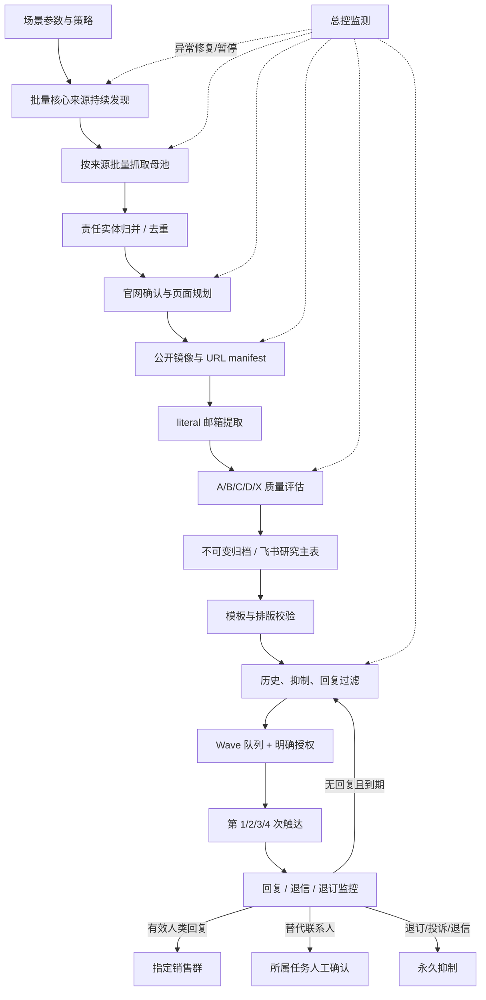

<title>英国天然草坪｜AcmeCorp Pro｜自动调研、开发信与有效回复监控 SOP v1</title>

版本：v1.0 ｜ 状态：流程基线，待英国验证闭环验收 ｜ 日期：2026-09-10

适用对象：海外终端研究、开发信运营、邮件回复监控与销售交接负责人。本 SOP 以英国户外天然草坪运动场为首个验证场景，设计为“国家 + 产品 + 场景”可参数化复用的全链路。

<callout emoji="💡">
本文定义自动化运行边界，不构成客户邮件发送授权。研究、队列构建、模板验证可以自动化；每次外发 wave 仍须活动级明确授权、收件人 manifest、跨线程去重、抑制和回复过滤。英国天然草坪研究链当前暂停；发布本文不会恢复研究、发信或监控。
</callout>

# 目标、成功定义与边界

## 最终商业目标

用公开、可审计的业务邮箱持续触达真正可能关注 EXD AcmeCorp Pro 户外真草坪划线、愿意推动或观看 demo 的责任人，并把有效人类回复稳定路由给销售。

ROI 不以母池数、下载页数或泛邮箱数为成功，而以新增合格公开邮箱、A/B 关键路线覆盖、每百镜像页有效路线产出、有效回复率和 demo 转化为核心。

## 参数化输入

| 参数 | 英国验证值 | 复用时替换 |
|-|-|-|
| 国家/语言 | 英国 / 英语 | 国家、地区、语言和合规边界 |
| 产品/场景 | EXD AcmeCorp Pro / 户外天然草坪运动场划线 | 产品能力、资产、施工或维护任务 |
| 合格资产 | 有公开证据的真草坪足球、橄榄球、板球等运动场 | 天然草、室外、运动类型和布局规则 |
| 硬排除 | golf、footgolf、人工草、3G/4G/5G、hybrid（无独立真草证据）、室内、MUGA | 不适配或会污染目标客户的场景 |
| 责任实体 | 拥有、运营、维护、预约控制或采购该资产的学校、大学、俱乐部、市政、公园、场馆或运营承包方 | 购买、影响或现场使用责任方 |

## 硬性边界

- 只研究公开网页、公开 PDF、公开 API 或合法公开数据；不得登录、绕过限制、提交表单、抓取私有页面。
- 只保留页面明确出现的 literal 邮箱；不得猜测、生成、购买、SMTP 验证或探测。
- 研究归档、飞书同步和模板验证均不等于发信授权。
- 实际客户外发、转发、销售群提醒和外部写入必须有对应活动授权、名单与安全门。

# 总体架构与职责

| 模块 | 唯一职责 | 完成证据 |
|-|-|-|
| A 策略与来源 | 定义场景并持续发现可批量来源 | 版本化策略、来源地图、覆盖说明 |
| B 母池 | 从来源物化场地和责任实体 | source_method_id、原始 URL、批次 receipt |
| C 官网/网页 | 确认责任关系并优选高价值官方页面 | 账户、官网、页面计划 |
| D 镜像/邮箱 | 镜像公开页面、提取邮箱、质量分层 | manifest、哈希、evidence、分类明细 |
| E 归档/队列 | 去重、飞书同步、构建候选队列 | 主表回读和 wave manifest |
| F 发送/监控 | 按授权外发并处理第 1-4 次触达与回复 | 发送日志、抑制日志、销售交接 |
| G 总控 | 监测异常、自动修复、暂停和汇总 | 状态、异常、恢复或暂停 receipt |

# 模块 A：策略与批量核心来源

1. 先固化场景 brief：国家、产品、资产条件、硬排除、责任实体类型、角色矩阵、语言、发件人、模板和目标动作。
2. 把场地资产和责任实体分开；账户单位是拥有、运营、维护、预约控制或采购的实体，不是单个 pitch。
3. 优先角色包括 Grounds Supervisor/Manager、Head Groundskeeper、Sports Turf Manager、Pitch Manager、Facilities/Maintenance/Estates、Operations、Procurement、Venue/Facility Manager。岗位须与现场、设备、维护、项目或采购责任强绑定。
4. 持续发现多类批量来源：全国/区域地图目录、协会/联赛资源、市政 GIS、学校/大学场地目录、俱乐部/公园网络、公开注册或 API。Pitchfinder 只是英国的一条来源，England 覆盖不等于英国全量。

来源发现是常驻供给模块，不能等母池枯竭再寻找。每个来源有独立 source_method_id，记录覆盖、粒度、字段、访问方式、限速、缺口、去重键和最近验证时间。搜索结果、单页新闻或单一 contact 页只能作补充证据，不能当全量母池。

## 动态批次原则

来源抓取和母池封存是两个独立动作。抓取负责高速连续获取候选，封存负责规范化、责任实体归并和去重。下游按上游实际交接数量消费，不能把 200/300 条强行切回固定 100 条；批次大小以 receipt 中的数量为准。来源持续供给不因下游短时积压而丢失，转入可审计缓冲。

# 模块 B：母池、官网和页面规划

## 母池最低字段

| 字段 | 要求 |
|-|-|
| source_method_id / source URL | 可回到发现来源与原始记录 |
| 资产名称、地点、地区 | 区分同名实体、单个场地和场地组合 |
| 天然草/运动证据 | 公开文本、标签、地图属性或官方说明 |
| 责任实体证据 | 所有、运营、维护、预约或采购关联 |
| 官网与归并键 | 主域、地址/邮编、公开 ID 或实体关联 |
| 准入 | eligible / hold / irrelevant / duplicate 及理由 |

## 官网与网页预检

1. 确认官方入口公开可访问，最终域名与责任实体关系可解释；第三方目录和社媒不能直接当官网。
2. 优先规划 Grounds、Sports Turf、Facilities、Estates、Maintenance、Operations、Procurement、Team/Staff、Venue Hire/Bookings、Projects、Contact、网站地图和公开 PDF。
3. P1：相关人/岗位/邮箱同一记录块；P2：相关岗位/部门与邮箱绑定；P3：场地和责任关系证据但无邮箱；P4：官方通用 contact/booking 兜底，每账户最多一个。
4. 低概率但可触达的官方预约、场地租赁、场馆运营和 contact 入口保留为 C/D，但不挤占 P1/P2 容量。

<callout emoji="🔎">
预检只负责排序和形成抓取计划，不再增加一层人工阻塞审核。已证明公开官网和场景关系的 P1/P2/P3 页面直接进入镜像；关系不清的记录转 hold。
</callout>

# 模块 C：镜像、literal 邮箱与 A/B/C/D/X

## 镜像与证据

1. 只下载已规划的公开网页和附件，遵守访问方式和限速。
2. 每请求记录 URL、最终 URL、状态、抓取时间、content-type、SHA-256、本地路径、页面优先级和失败原因。
3. 同 URL/内容哈希重复时避免重复抓取，但保留账户关联。
4. 失败、受限、空页、非 HTML/PDF 或跳转无关域，写入 blocked/no_route，不伪装成已研究。

每条邮箱必须来自本地镜像中明确出现的 literal 文本，并保留账户 ID、邮箱、页面 URL、证据文本、有限记录块、岗位/部门、业务功能、抓取时间和页面哈希。页面上其他组织的目录邮箱不得因同页出现而归属目标账户。

| 层级 | 标准 | 定位 |
|-|-|-|
| A | 关键决策或 demo 推进职能 + 真实公开业务邮箱 + 强绑定 | 最高优先；发送前仍需活动级具名/域名/证据校验 |
| B | 关键一线运营/维护角色 + 真实公开邮箱 + 强绑定，如 Grounds Supervisor、Grounds Manager、Sports Turf Manager、Pitch Manager、Facilities/Maintenance Supervisor | 高优先 demo 影响路线 |
| C | 目标账户绑定且有 grounds/facilities/venue/bookings/operations 业务语境的官方入口 | 业务入口；可请求转交负责人 |
| D | 目标账户绑定的公开真实泛化官方邮箱 | 低优先触达储备，单独统计 |
| X | 无关岗位、非目标绑定、目录他人、no-reply、招生/HR/财务/教学/一般行政、推断或硬排除 | 不进入有效主表；保留审计原因 |

岗位/职能必须与产品场景强绑定。Bookings 只有在明确是场地预约、场馆运营或设施团队入口时进 C；无场地关联的客服/预订进 X。行政、招生、一般客服即使公开也不能因“可能转发”进入有效主池。

## 去重与不可变修订

以账户 ID + 产品场景 + 小写邮箱为基础键，另比对 route_evidence、已发送历史和抑制记录。旧路线不计新增。后续发现错误时追加撤回/降级记录，不静默覆盖历史判断。

# 模块 D：研究归档与飞书主表

研究层交付：独立母池、page_mirror/URL manifest、route_evidence_new_only.csv、strict_named_role_email.csv、observed_business_route_candidates.csv、no_route/blocked/irrelevant 明细、批次 ROI、不可变修订。所有记录标记 research_only=true、send_authorized=false。

飞书主表是合格路线的统一可见层，不是发送指令。写入前做资格校验、跨线程去重和回读；写入后保存行 ID、质量层级、证据 URL、策略版本和来源批次。C/D 必须标为业务入口/通用入口，不得与 A/B 混称关键联系人。

## 交接契约

只有在字段模式、CSV 哈希、manifest、receipt 和失败项一致时才交接。统一字段至少包括 batch_id、campaign/profile/strategy 版本、账户 ID、数量、路径、SHA-256、状态、创建时间、来源任务。契约不匹配即 fail closed：不消费、不计数、不写主表，生成异常单。

# 模块 E：模板、排版与发送授权

模板线程集中管理国家/语言、A/B/C/D 层级和第 1/2/3/4 次触达版本；负责变量、语言、CTA、链接、退订文案和排版，不改变邮箱质量、不自行扩展收件人。

EXD DOCX 外联使用共享基线 exd-docx-outreach-left-aligned-v1：自然左对齐、正文最大 720px、CID inline 图片、保留原始 GIF 动画与尺寸。本文只定义规则，不创建或发送邮件。

1. 按 A→B→C→D 生成候选 wave，D 不挤占 A/B 容量。
2. 重建全工作区跨线程发送历史；第一触达排除所有已发，后续触达必须证明上一触达已发且无有效回复。
3. 应用退订、投诉、退信、无效邮箱、抑制、重复发送、未决投递和未完成历史对账过滤。
4. 生成不可变 wave manifest：活动、模板/策略版本、收件人、层级、证据、发件人、阶段、时间窗、数量、过滤结果。
5. 只有明确 campaign/wave 发送授权覆盖 manifest，才可进入外发；缺授权、证据不一致或安全校验失败即停在 prepared_pending_authorization。

<callout emoji="🛑">
自动化不等于无条件自动发送。若未来使用预批准发送窗口，必须限定活动、模板、发件人、数量、时间窗、国家/法律边界、异常停止阈值和撤销方式；去重、退订、退信和回复过滤仍不可省略。
</callout>

# 模块 F：第 1/2/3/4 次触达

| 阶段 | 进入条件 | 禁止条件 |
|-|-|-|
| 第 1 次 | 合格路线、manifest、明确授权 | 已发、抑制、证据缺失、历史未对账 |
| 第 2 次 | 第 1 次已确认、等待期到期、无回复、未退订/退信 | 未确认或有任何需停止事件 |
| 第 3/4 次 | 前一阶段已确认、等待期到期、无有效回复，且活动授权允许 | 回复、退订、投诉、退信、投递异常或达到最大次数 |

发送线程只消费已授权 manifest，不自行找邮箱、不扩展名单、不以研究完成为理由发送。每次发送写入阶段日志，供监控与下一波筛选使用。

# 模块 G：回复、退信与销售路由

| 结果 | 自动动作 | 状态 |
|-|-|-|
| 有效人类回复：兴趣、询价、demo、负责人确认、可执行转介 | 摘要和证据路由指定销售群；停止后续触达 | effective_reply / sales_handoff |
| 退订/投诉 | 立即永久抑制 | suppressed |
| 硬退信/无效地址 | 抑制该地址并保留投递证据 | invalid_or_bounced |
| OOO/自动确认/系统消息 | 仅记录，不进销售群 | log_only / deferred |
| 模糊人类回复 | 进入所属 Codex 任务编号复核清单，不发默认飞书审查卡 | manual_review_hold |
| 明确给出不同 literal 替代联系人 | 作为 routing 事件，不自动转发/重发 | awaiting_Member_A_confirmation |

人工复核项保留 message_id、发件箱、发件人、主题、原始收件人、最新回复摘要、分类和建议动作。替代地址只有经 Member-A 在所属任务确认后，才生成独立一人首触达队列，并重新执行抑制、历史、授权和 No-Go 校验。

# 状态机、异常监控与暂停恢复

账户：discovered → eligible/hold/irrelevant/duplicate → researched → archived。路线：observed → A/B/C/D/X → queued_candidate → prepared_pending_authorization → sent_stage_1/2/3/4 → reply/suppressed/bounced/manual_review/closed。每次迁移写时间、模块、原因和证据。

总控只检查心跳、receipt、积压、错误率、重复率、抓取成功率、质量分布、发送/回复状态和看板新鲜度。模块应自治持续运行：来源持续供给，母池持续物化，网页/邮箱持续消费合格批次。总控不做逐批人工派工。

1. 短暂错误按预设次数和退避重试，并写恢复 receipt。
2. 交接、质量、重复计数、抑制、授权或日志异常立即 fail closed，不消费、不写主表、不发信。
3. 无法自动修复的系统性异常进入安全静默暂停，保留一致 checkpoint，并单次通知用户；禁止夜间无意义消耗 token。
4. 恢复前做只读 precheck，确认原因解除、契约一致、去重/抑制回读通过、缓冲完整，从最后验证 checkpoint 继续。

# KPI、复盘与验收

| 结果看板 | 效率/质量看板 |
|-|-|
| 有效邮箱总数与 A/B/C/D 数量 | 每来源候选、合格账户率、官网确认率 |
| 已授权/已发送及第 1-4 次触达数量 | 每百镜像页 A/B/C/D 产出、P1/P2 命中率 |
| 有效回复、demo 意向、转介、退订、退信 | 每账户页面数、重复率、blocked/no_route、端到端延迟 |
| 销售群已路由回复与处理状态 | 来源、页面、角色、模板、时间窗 ROI |

每批输出：完成账户、新增唯一路线、新增 A/B、新增 C/D、每百镜像页有效路线、去重/撤回数、blocked/no_route 原因。30 分钟只报进度和异常，不作为来源淘汰理由。

## 英国验证教训

- 过度拆线程和人工提示交接会停滞；应保留模块边界但用统一 receipt 自动衔接。
- 母池必须持续多源发现；一个 England 来源不等于英国全量，一条母池记录可生成多个官网、团队、设施、预约、项目和 PDF 页面。
- 官网可解析不等于责任关系成立；页面有邮箱不等于邮箱属于目标账户。
- 通用 contact/目录页会造成 D 虚高；C/D 可保留，但不能包装成关键 demo 联系人。
- 质量规则改变必须追加式修订，不能静默重新计数。

## 规模化前验收

- [ ] 策略、角色、资产准入和硬排除已版本化。

- [ ] 至少两个批量核心来源已验证覆盖和去重。

- [ ] 母池→官网→镜像→邮箱→归档端到端试跑无人工补字段。

- [ ] literal evidence、同记录块绑定、A/B/C/D/X 抽样审计通过。

- [ ] 飞书主表回读、跨线程去重、历史发送/抑制过滤通过。

- [ ] 模板/排版、语言、发件人和 A/B/C/D 触达规则已批准。

- [ ] wave manifest 和明确授权缺失时的 fail closed 已验证。

- [ ] 回复分类、永久抑制、替代联系人确认、销售群路由和任务内复核已完成无客户外写测试。

- [ ] 总控已验证正常静默、异常修复、单次通知、安全暂停和 checkpoint 恢复。

# 执行结论

全自动化的关键不是增加人工线程，而是让每个模块有单一职责、稳定交接契约和可恢复状态：上游持续多源供给，中游优先高价值官方页面并以证据约束邮箱归属，下游严格隔离研究、授权发送和回复路由。A/B 保障质量，C/D 保留覆盖；授权、去重、抑制和回复门控保障安全与长期 ROI。
